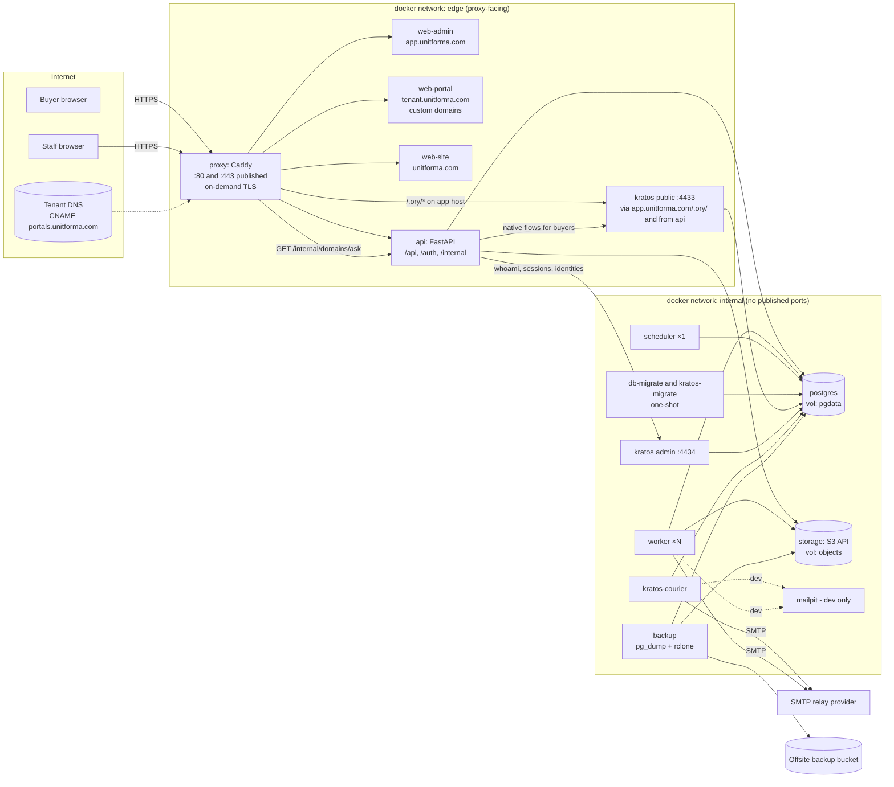
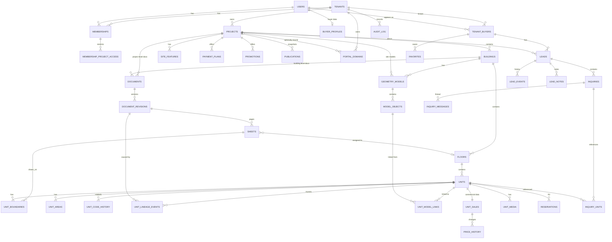
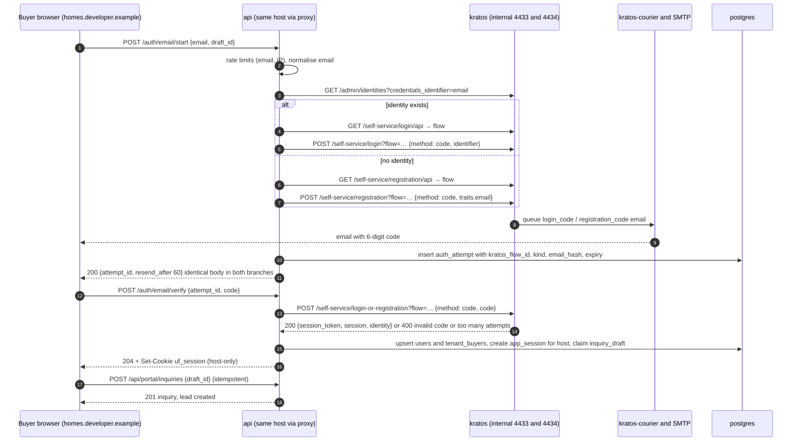
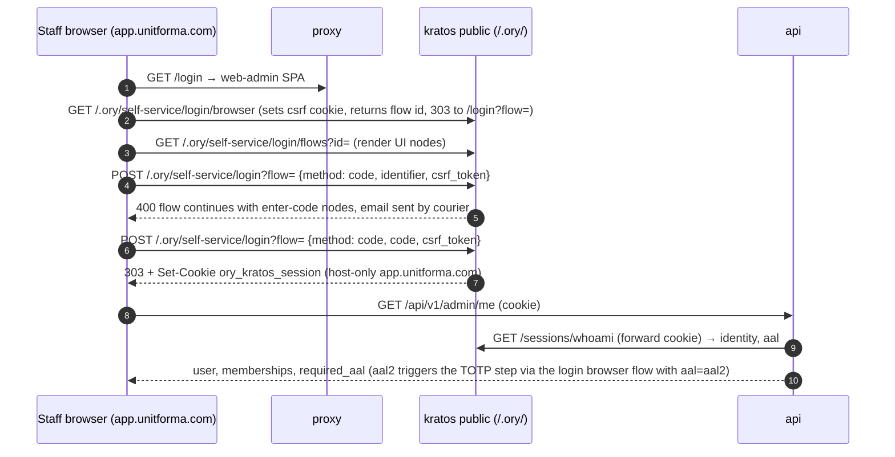
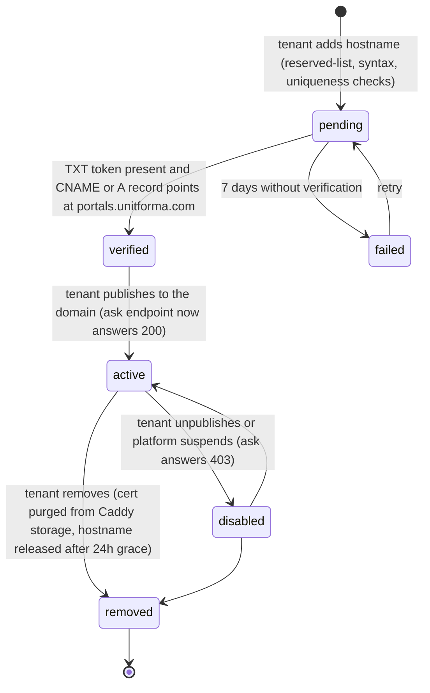
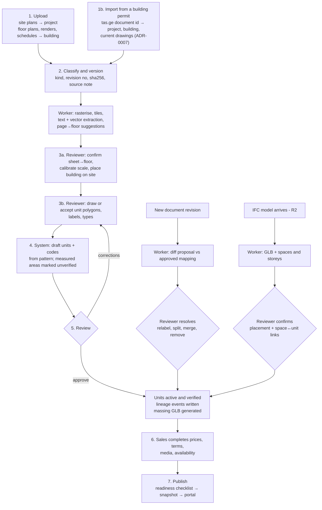

# Unitforma — Architecture and Delivery Plan

**Status:** planning deliverable, v0.1 (2026-10-25). Implementation status: Phases 0–4 (scaffold, core platform, documents/mapping, sales workspace, publishing and buyer portal) are on `main`, plus multi-floor sheets, filled-zone outlines, level-marker floor suggestions, legacy Georgian font decoding, typed unit labels (parking, storage), printed areas and sheet exclusion from the first pilot drawing set (§13.2 notes); see README. Next: Phase 5 buyer accounts and inquiries.
**Prepared for:** Unitforma (https://unitforma.com), repository `Datikos/unitforma`, branch `claude/epic-lovelace-sr9pyy`.

## How to read this document

Every statement in this plan is tagged with one of five labels so the team can tell requirement from opinion:

| Tag | Meaning |
|---|---|
| **[REQ]** | Confirmed requirement from the brief. |
| **[REC]** | Recommendation. Justified in the text, can be overturned. |
| **[ASSUME]** | Assumption made to keep the plan concrete. Listed in §0.3; please confirm or correct. |
| **[OPEN]** | Unresolved decision that materially affects architecture or scope. Listed in §0.4. |
| **[VALIDATE]** | Capability that needs a technical proof-of-concept before we rely on it. Listed in §19.2. |

Facts about third-party software were checked against official documentation on 2026-10-25; sources are cited inline and collected in §21. Where a fact could not be verified it is marked **UNVERIFIED**.

### Coverage of the requested outputs

| Requested output | Section |
|---|---|
| 1 Product definition and user journeys | §1 |
| 2 Scope: MVP / next / advanced | §2 |
| 3 Architecture and container diagram (responsibilities, networks, storage, ports, trust boundaries) | §3.1–3.3, §17.1–17.3 |
| 4 Technology choices and alternatives | §4 |
| 5 PostgreSQL entity model and ER diagram | §5 |
| 6 Authentication sequence diagrams incl. custom domains | §8.3–8.5 |
| 7 Angular structure and screens | §11 |
| 8 Python modules, API boundaries, background jobs | §12 |
| 9 Document-to-published-project workflow | §13 |
| 10 Ordered phases with dependencies, deliverables, exit criteria | §14 |
| 11 Backlog (epics → tasks) | §15 |
| 12 Repository structure | §16 |
| 13 Docker dev/prod design, updates, rollback, secrets, monitoring, backups, CI/CD | §17 |
| 14 Testing strategy | §18 |
| 15 Risks and early PoCs | §19 |
| 16 Effort ranges and assumptions | §20, §0.3 |

## 0. Repository inspection result

The repository `Datikos/unitforma` was cloned and inspected on branch `claude/epic-lovelace-sr9pyy` (identical to `main`).

- It contains a single commit ("Initial commit") with exactly one file: `.gitignore`, an Angular-oriented ignore list.
- There is **no README, no AGENTS.md, no CLAUDE.md, no code, no CI configuration**. There are therefore no repository instructions to follow or existing work to preserve beyond the ignore file.
- One observation for later: the `.gitignore` ignores `/package-lock.json` and `/yarn.lock`. For reproducible Docker image builds the lockfile must be committed, so this line should be removed when the frontend workspace is created (§12).
- The "attached visual concept" mentioned in the brief was **not available in this session** (no attachment reached the repository or the task text). The plan treats it as the user described it: a design direction whose apartment IDs, dimensions, layouts and prices are illustrative. Nothing in the data model or workflow depends on it.

Nothing was modified or committed. This document lives outside the repository until you decide to add it (suggested location: `docs/architecture/plan-v0.1.md`, see §16).

### 0.1 Executive summary

Unitforma is a multi-tenant platform that turns a property developer's drawings and renders into a published, interactive sales portal, with a human-verified mapping step between the two. The recommended architecture is deliberately boring where it can be and specific where it must be:

- **A modular Python monolith (FastAPI) plus a worker pool**, one Angular workspace producing three small browser applications (admin workspace, buyer portal, authentication UI), PostgreSQL with row-level security as a second line of tenant isolation, S3-compatible object storage, Ory Kratos for identity, and Caddy as the single public entry point providing automatic TLS for tenant subdomains and developer-owned domains.
- **Unit identity is the core asset.** Every unit has a permanent UUID, a readable code that can change, an explicit lineage (created / relabelled / split / merged / removed) across document and model revisions, and three independent states: architectural verification, publication, and sales availability.
- **Authentication across unrelated custom domains** is solved with a central account domain (`accounts.unitforma.com`) that owns the Kratos session, and a short-lived single-use handoff code that establishes a host-scoped application session on each portal domain. This avoids both shared cookies (impossible across domains) and a full OAuth2/OIDC server (not needed when every relying party is our own backend).
- **Everything deploys with Docker Compose**: each application, service, worker and infrastructure component in its own container, private by default, with one-shot migration containers, health-gated start-up, pinned image tags per module, and documented backup and restore.
- **The first end-to-end milestone** (tenant → project → PDF upload → verified mapping → sales data → published portal → email-code login → inquiry visible to sales) is reachable without Archicad or IFC files, with a schematic 3D massing view generated from the verified floor-plan polygons. IFC geometry attaches to existing unit records later through a reviewed matching step and never replaces the sales or identity model.

### 0.2 Non-goals for the first release

- No automatic extraction of dimensionally exact geometry from PDFs or AI images. **[REQ]**
- No payments, deposits, or contract signing.
- No tenant billing or subscription management for the platform itself. **[ASSUME A7]**
- No native mobile apps; responsive web only. **[ASSUME A5]**
- No CRM integrations (HubSpot, Salesforce, etc.) beyond CSV export. **[ASSUME A8]**

### 0.3 Assumptions

| ID | Assumption | Impact if wrong |
|---|---|---|
| A1 | Production starts on a **single Linux host** (VM/VPS, e.g. 8 vCPU / 32 GB / NVMe + attached block storage) running Docker Compose, in the EU. Scale-out to multiple hosts or Kubernetes is a later concern. | Changes the production Compose design, backups, and TLS storage (Caddy would need shared storage for certificates). |
| A2 | The team is **4–6 engineers** (see §20) with Angular and Python experience but limited prior 3D/BIM experience. | Effort ranges shift; 3D scope may need an external specialist. |
| A3 | Tenants are developers in one or a few countries; **multi-currency is required per project, multi-language UI is not required in MVP** (English UI, tenant-supplied content text in any language; i18n scaffolding in place). | Adds a translation layer to content fields and UI early. |
| A4 | Buyer accounts are **one platform identity per email**, with tenant-scoped relationships (recommended in §8.6). | Would require per-tenant identity schemas and separate Kratos instances; large change. |
| A5 | Responsive web only, no native apps. | Would require a public mobile API contract and app store workflows. |
| A6 | Transactional email is sent through a **third-party SMTP relay** (e.g. Postmark, SES, Resend), not a self-hosted MTA. | Self-hosting mail adds deliverability work (IP reputation, DKIM, bounce handling) not planned here. |
| A7 | Platform billing of tenants is out of scope. | Adds subscriptions, invoices, plan limits. |
| A8 | No third-party CRM integration in MVP. | Adds webhook/outbox integration work. |
| A9 | The marketing site `unitforma.com` is a **static site** (any generator or external builder) served by the same proxy; it is not an Angular application. | Adds a fourth application if dynamic. |
| A10 | Reservations (time-boxed holds) are **not** in the first milestone but the data model leaves room for them (§6.5). | If required early, add ~3–4 weeks to Phase 3. |
| A11 | "Sales staff can complete commercial information" means staff enter data manually or via spreadsheet; no ERP integration. | ERP integration would be a separate epic. |
| A12 | Expected scale for the first year: ≤ 50 tenants, ≤ 200 projects, ≤ 50 000 units, ≤ 100 custom domains, portal traffic in the low thousands of sessions per day. | Beyond this, add a CDN, read replicas and multi-host deployment. |

### 0.4 Open decisions (need your input, none block Phase 0)

| ID | Question | Why it matters | Default if no answer |
|---|---|---|---|
| O1 | Hosting target and region (single EU VPS vs. cloud account with managed Postgres/S3)? | Decides whether PostgreSQL and object storage are containers in production or managed services; affects backup design and cost. | Single host, everything in containers, offsite backup to an S3 bucket. |
| O2 | Which countries/currencies/languages for the first tenants? Any legal requirement on where buyer data is stored? | Data residency, locale formatting, consent texts, VAT display rules. | EU hosting, per-project currency, English UI. |
| O3 | Are reservations (holds with expiry) required in the first release? | Adds state machine, expiry worker, conflict handling. | Next release. |
| O4 | Which transactional email provider? Do tenants need to send from their own domain (requires their DKIM setup) or from `@mail.unitforma.com` with reply-to? | Email templates, DNS instructions, and sender reputation. | Platform sender with tenant branding and reply-to. |
| O5 | Staff MFA policy: require a second factor for tenant admins in MVP, or next release? | Kratos configuration (TOTP/WebAuthn/passkeys) and the staff onboarding flow. | Platform admins MFA in MVP; tenant staff MFA in next release. |
| O6 | Should the buyer be able to see the same account across different developers' portals (shared favourites/inquiry history), or should each portal show only that tenant's data? | Portal account page design and privacy posture. | Each portal shows only that tenant's data; the account itself is shared (one login). |
| O7 | Is a marketing website in scope for this team? | Scope and a possible fourth frontend. | Out of scope; static placeholder. |
| O8 | Who are the first pilot developer(s), and can they supply one real project's PDFs and renders for Phase 0? | The mapping workflow must be designed against real drawings; synthetic samples hide problems. | Use publicly available sample plans; higher risk. |

---

## 1. Product definition and user journeys

### 1.1 Product definition

Unitforma lets a property developer (a **tenant**) upload what it already has about a development (site plans, floor-plan PDFs, exterior renders, later Archicad/IFC models), prepare a verified inventory of sellable units from those documents with human review, attach prices and terms, and publish a branded buyer portal on a Unitforma subdomain or the developer's own domain. Buyers browse anonymously, explore the site, buildings, floors and units in 2D and 3D, filter by availability, price, area and rooms, save favourites, and after a one-time email code login submit inquiries (general, viewing, merge, redesign, finish quotation) that land as leads in the developer's sales workspace.

The platform explicitly separates three things that are often conflated:

1. **What the architect verified** (geometry, areas, unit existence) — the architectural verification state.
2. **What the public can see** — the publication state.
3. **What is for sale and at what price** — the sales availability state.

### 1.2 Personas and roles

| Persona | Role name in system | Scope | Typical goals |
|---|---|---|---|
| Unitforma operations | `platform_admin` | Platform-wide | Create tenants, approve custom domains, support, monitor. |
| Developer company owner / IT | `tenant_admin` | One tenant | Manage users, branding, domains, settings; see everything in the tenant. |
| Project lead at the developer | `project_manager` | Assigned projects | Set up buildings/floors, upload documents, publish, oversee sales. |
| Architect / technical reviewer (in-house or external) | `architectural_reviewer` | Assigned projects | Calibrate drawings, draw/correct unit boundaries, approve mappings, review IFC matches, approve redesign proposals. |
| Sales agent | `sales` | Assigned projects | Enter prices/terms, manage availability, handle leads, respond to buyers. |
| Buyer | buyer (platform identity, tenant-scoped lead) | Public portals | Explore, compare, save, inquire, follow up. |

Role scope: platform roles are global; tenant roles are per membership; project restriction is per membership (a `sales` user can be limited to projects X and Y). Details in §3.

### 1.3 User journeys

**J1 — Tenant onboarding (platform admin → tenant admin).** Platform admin creates a tenant with slug `{tenant}` (reserving `{tenant}.unitforma.com`), invites the first tenant admin by email. The tenant admin accepts the invitation (Kratos recovery-style link → sets up their credential), lands in `app.unitforma.com`, sets branding (logo, colours, legal footer) and invites colleagues with roles and project restrictions.

**J2 — Project setup (project manager).** Creates a project (name, slug, address, currency, area definition set), adds buildings (code "A", "B", …), defines floors per building (level numbers and display names, e.g. "-1 Parking", "0 Ground", "1"–"12"), uploads the site plan and per-building floor-plan PDFs and exterior renders.

**J3 — Document preparation and mapping (reviewer, assisted by the worker).** Each uploaded file becomes a document with revision 1. The worker rasterises PDF pages, extracts text and vector candidates, and proposes a page → floor assignment. The reviewer confirms the assignment, calibrates the scale of each sheet (two-point distance or a known dimension), places the building footprint on the site plan, draws or accepts proposed unit polygons, assigns unit types and labels, and approves. Approval creates or updates permanent unit records. Later revisions are diffed against the approved mapping; the reviewer resolves relabels, splits, merges and removals explicitly.

**J4 — Commercial completion (sales).** In the inventory grid the sales user fills prices (or leaves them empty), currency, payment plans, promotions, descriptions, room counts, media, and sets availability. Bulk edit and spreadsheet import with validation preview; every change is audited and protected against concurrent overwrites.

**J5 — Publication (project manager).** Preview the portal on `{tenant}.unitforma.com/projects/{slug}?preview=…`, choose which fields are public, publish. Publication creates an immutable snapshot that the portal serves; unpublishing or re-publishing is a new snapshot. Optionally connect `homes.developer.example` by following DNS instructions; once verified, TLS is issued automatically and the portal is live there.

**J6 — Buyer exploration (anonymous).** Lands on the portal, sees the site (2D plan with building footprints; schematic 3D massing when the device can load it), picks a building, flips through floors, filters, opens unit pages (plan, renders, area table with definitions, price or "price on request", payment terms, 3D view), saves favourites locally.

**J7 — Buyer inquiry with email-code login.** Buyer fills a viewing request on a unit page. Submitting opens the login step: email → 6-digit code by email → verified. New buyers get an account in that step; returning buyers reuse theirs. The pending inquiry (project, unit, selected options) is submitted once, the buyer sees it in their inquiry history, sales sees a new lead with the buyer's verified email, assigned by rules or manually, and responds; the buyer gets an email and sees the response in the portal.

**J8 — Revision after model delivery (reviewer).** Months later the architect supplies IFC exports. The worker converts them to glTF and lists spaces/storeys. The reviewer confirms the building placement and matches IFC spaces to existing units (auto-suggested by storey + label + position). Existing unit IDs, prices, leads and favourites are untouched; the unit now has a verified 3D object and (if accepted) IFC-derived areas marked with their source.

**J9 — Buyer proposal (next release).** A buyer requests merging two adjacent units or a developer-assisted redesign; the request is a lead with a proposal payload, visible to sales and reviewers; nothing changes in inventory until the developer acts.

---

## 2. Scope by release

### 2.1 MVP — Milestone 1 "first end-to-end sale path" **[REQ]**

Must run in Docker Compose with every deployable module in its own container.

| Area | In MVP |
|---|---|
| Tenancy | Tenant creation by platform admin; tenant users, roles, project restrictions; branding (logo, colours, contact footer); audit log. |
| Projects | Project → buildings → floors → units; unit types apartment / commercial / parking / storage; project-level site plan and amenities list; building placement on the site plan (2D position, rotation, scale). |
| Documents | Upload (PDF, PNG/JPG, later IFC/GLB), classification (site plan, floor plan, section/elevation, render, schedule, other), revisions with hashes, page rasterisation and tiles, text extraction. |
| Mapping | Sheet → floor assignment, scale calibration, polygon editor, draft unit generation with readable codes, review/approve, lineage (create / relabel / split / merge / remove), area entries with type, source and verification status. |
| Sales | Availability (available / reserved / sold / withdrawn — "reserved" as a manual status only), price + currency (nullable), price per m² (computed from a chosen area type), payment plans and promotions as structured text, descriptions, room counts, media; bulk edit, CSV/XLSX import with dry-run; optimistic concurrency; audit history; public vs internal field separation. |
| Publishing | Publication snapshots per project, preview mode, publish/unpublish, tenant subdomain portals, custom domains with DNS verification and automatic TLS. |
| Buyer portal | Responsive portal: project page, site view (2D + schematic 3D massing when supported), building and floor navigation, filters, unit page, favourites (local + account), inquiry forms (general, viewing, merge request, redesign request as free text + unit refs), inquiry history. |
| Authentication | Kratos email one-time-code login/registration for buyers; staff invitations; central account domain + handoff sessions on every portal host; logout; recovery; email change. |
| Leads | Tenant-scoped leads, inquiry types, assignment, status history, notes, follow-up dates, email notifications, duplicate protection, source/UTM capture, consent record, buyer-facing responses. |
| Operations | Compose for dev and prod, health checks, migrations, backups/restore, CI building per-module images, basic monitoring (health + logs + uptime), rollback by tag. |

### 2.2 Next release (R2)

- Detailed 3D: IFC ingestion (IfcOpenShell), glTF conversion, space/storey extraction, reviewed matching to units, per-unit 3D highlight and apartment interior view where geometry exists.
- Reservations with expiry, conflict handling, reservation → sold transitions. **[OPEN O3]**
- Staff MFA (TOTP / passkeys) and session policies. **[OPEN O5]**
- Finishing-material catalogue (view-only, platform supplied), finish quotation requests with selected options.
- Server-side rendering for portal SEO, sitemaps, Open Graph. Analytics events and campaign dashboards.
- Spreadsheet export, saved views, lead pipeline views, email templates per tenant.
- Developer-owned email sender domains. **[OPEN O4]**

### 2.3 Advanced (R3+)

- Controlled self-redesign: buyer moves non-structural partitions in a constrained editor; structural elements and restricted areas locked; proposals go through developer approval.
- AI-generated illustrative previews (interior styling of a verified plan), always watermarked "illustrative".
- Merge-feasibility assistant (adjacency graph from verified polygons/IFC spaces).
- Multi-language content, buyer document sharing, CRM/webhook integrations, multi-host deployment, CDN.

---

## 3. Recommended architecture

### 3.1 Deployable module boundaries **[REC]**

A **modular monolith plus workers**, not microservices. One Python codebase produces one image that runs in three roles (API, worker, scheduler); one Angular workspace produces three static bundles each served by its own container. Infrastructure components are separate official images.

| Module (container) | Image | Role | Exposed to internet | Networks |
|---|---|---|---|---|
| `proxy` | `caddy` (official, custom build with on-demand TLS `ask` is core; rate-limit plugin via `xcaddy` optional) | TLS termination, host routing, on-demand certificates for tenant and custom domains, static caching headers, request-size limits | **Yes: 80/443** | `edge` |
| `web-admin` | own, `nginx`/`caddy` base serving the Angular `admin` build | Developer administration and sales workspace at `app.unitforma.com` | via proxy | `edge` |
| `web-portal` | own, same base, Angular `portal` build | Buyer portals on `{tenant}.unitforma.com` and custom domains | via proxy | `edge` |
| `web-site` | static site image (e.g. `caddy` serving `/srv`) | Marketing site `unitforma.com` **[ASSUME A9]** | via proxy | `edge` |
| `api` | own (`backend/Dockerfile`, target `api`) | FastAPI application: admin API, portal API, auth/handoff API, internal endpoints (Caddy `ask`, health) | via proxy (`/api/*`, `/auth/*`, `/.well-known/*` only) | `edge`, `internal` |
| `worker` | same image, command `worker` | Background jobs: document processing, geometry conversion, imports/exports, email sending, snapshots | No | `internal` |
| `scheduler` | same image, command `scheduler` | Periodic jobs: domain re-verification, reservation expiry, retention, outbox retry (single replica) | No | `internal` |
| `db-migrate` | same image, command `alembic upgrade head` | One-shot schema migration, runs before `api`/`worker` start | No | `internal` |
| `kratos` | `oryd/kratos` | Identity: public API on 4433 (proxied only under `app.unitforma.com/.ory/*` for staff browser flows; called internally by `api` for buyer flows), admin API on 4434 (private) | public API via proxy path only | `edge`, `internal` |
| `kratos-migrate` | `oryd/kratos`, command `migrate sql -e --yes` | One-shot Kratos schema migration | No | `internal` |
| `kratos-courier` | `oryd/kratos`, command `courier watch` | Sends Kratos emails (codes, recovery) via SMTP, decoupled from the API process | No | `internal` |
| `postgres` | `postgres` (official) | Two databases: `unitforma` (app) and `kratos` | No | `internal` |
| `storage` | S3-compatible (see §4.4) | Documents, renders, derived tiles, glTF assets, exports | No (served via API presigned URLs or proxy path) | `internal` (+ `edge` only if the proxy serves a public bucket) |
| `queue` | **none in MVP** — PostgreSQL-backed job queue (§4.3); `valkey` added when caching/rate-limit state needs it | | No | `internal` |
| `mailpit` (dev only) | `axllent/mailpit` | Catches all SMTP mail in development, exposes an API that E2E tests use to read codes | dev only | `internal` |
| `backup` | own small image (`postgres` client + `rclone`) | Nightly `pg_dump` + object storage sync to offsite bucket | No | `internal` |
| `observability` profile | `prom/prometheus`, `grafana/grafana`, `grafana/loki`, `grafana/alloy`, `louislam/uptime-kuma` | Metrics, logs, uptime (optional profile; see §17.7) | Grafana via proxy, admin-only | `internal` (+ proxy) |

Why one backend image for `api`, `worker`, `scheduler`, `db-migrate`: they share the domain model and migrations, so versioning them together is correct; separate containers still give independent scaling, restart and resource limits. Why two application frontends instead of one: different hosts and cookie scopes, different bundle sizes (the portal carries the 3D engine; the admin app carries the mapping editor and data grid), different audiences and release cadence. The staff login UI lives inside `web-admin` because Kratos browser flows require the UI and the Kratos public API on the same site (§8.2); the buyer login UI lives inside `web-portal` and talks only to our API (§8.3). An earlier draft had a third `web-auth` application on `accounts.unitforma.com`; it was dropped when the buyer flow moved to a backend-for-frontend design, see §8.4 for the comparison.

### 3.2 Container diagram



**Trust boundaries.**
1. *Internet → proxy*: only 80/443. Unknown `Host` → no certificate issued (TLS handshake fails) and HTTP 421/404. Request body limits (uploads go directly to object storage via presigned URLs, so the API accepts ≤ 10 MB bodies), security headers, rate limits on `/auth/*` and `/.ory/*`.
2. *Proxy → edge services*: plain HTTP on the Docker network; the proxy sets `X-Forwarded-*`; the API trusts these headers only from the proxy network.
3. *Edge → internal*: only `api` and `kratos` straddle both networks. PostgreSQL, storage, Kratos admin, workers are reachable solely from `internal`. No service publishes ports other than `proxy`.
4. *Tenant boundary*: enforced inside the API (authorization) and inside PostgreSQL (row-level security), see §3.4.
5. *Secrets*: Docker secrets files mounted at `/run/secrets/*`, never in images or `.env` committed to git (§17.4).

### 3.3 Request routing (finalised proposal) **[REC]**

| Host | Path | Target | Notes |
|---|---|---|---|
| `unitforma.com`, `www.` | `/*` | `web-site` | Static. |
| `app.unitforma.com` | `/api/*`, `/auth/*` | `api` | Admin API and app-session endpoints. |
| `app.unitforma.com` | `/*` | `web-admin` | SPA fallback to `index.html`. |
| `app.unitforma.com` | `/.ory/*` | `kratos` public (strip prefix) | Staff browser flows; same host as the admin UI so Kratos CSRF/session cookies are first-party (host-only cookies). |
| `{tenant}.unitforma.com`, custom domains | `/api/portal/*`, `/auth/*` | `api` | Host header resolves tenant/project; `/auth/*` is the buyer email-code BFF and session endpoints (§8.3). |
| `{tenant}.unitforma.com`, custom domains | `/*` | `web-portal` | Same bundle for all portals; branding fetched from `/api/portal/branding`. |
| `portals.unitforma.com` | — | CNAME target only | Developers point their hostnames here. Serves a generic "not configured" page. |
| any other host | — | 421 / no cert | Unknown-host rejection. |

Reserved subdomains (cannot be chosen as tenant slugs): `www, app, api, accounts, auth, login, admin, portals, cdn, static, assets, mail, smtp, imap, status, docs, help, support, dev, staging, test, demo, internal, ns1, ns2, mx, autodiscover, _dmarc` plus anything in the RFC 6761 reserved list and a blocklist of brand/offensive terms. Slugs: lowercase, `^[a-z0-9](?:[a-z0-9-]{1,61}[a-z0-9])?$`, no leading digit-only values, min 3 chars.

API base paths and versioning: `/api/v1/admin/...` (staff), `/api/v1/portal/...` (public + buyer), `/api/v1/auth/...` (handoff, session, logout), `/api/v1/platform/...` (platform admin), `/internal/...` (proxy-only: `ask`, health). OpenAPI generated by FastAPI; the Angular API client is generated from it in CI (§11).

### 3.4 Multi-tenancy and authorization design

**Identity vs membership.** Kratos stores *who* (identity id, verified email, credentials). The application stores *what they may do*:

- `users` — one row per Kratos identity (`kratos_identity_id` unique), platform flags (`is_platform_admin`).
- `memberships` — `(tenant_id, user_id)` unique, `role` ∈ {`tenant_admin`, `project_manager`, `sales`, `architectural_reviewer`}, `status` (invited/active/suspended), `all_projects` boolean.
- `membership_project_access` — `(membership_id, project_id)` for restricted staff.
- `buyer_profiles` — platform-level buyer attributes (display name, phone, marketing consent per tenant lives on the relationship).
- `tenant_buyers` — `(tenant_id, user_id)`: the tenant-visible buyer record; leads hang off this, never off the platform user directly.

**Authorization in the backend [REQ].** Every admin request resolves `(user, tenant, membership, project set)` from the session and the URL (`/admin/tenants/{tenant_id}/...`), then evaluates a permission matrix (`permission = f(role, resource, action)`) in a single policy module with unit tests. Project-scoped resources check that `project_id ∈ allowed_projects`. Portal requests resolve the tenant/project from the `Host` header (via `portal_domains`) and expose only published read models. Frontend route guards exist for UX only.

**Row-level security as defence in depth [REC, VALIDATE V4].** All tenant-owned tables carry `tenant_id` (denormalised, NOT NULL, FK). The API connects as a role `app_rw` that is **not** the table owner, and every request sets `SET LOCAL app.tenant_id = '<uuid>'` (and `app.user_id`, `app.role`) inside the transaction. Policies: `USING (tenant_id = current_setting('app.tenant_id')::uuid)`; tables get `ENABLE ROW LEVEL SECURITY` and `FORCE ROW LEVEL SECURITY` so even the owner role is checked when used accidentally (PostgreSQL: "Superusers and roles with the BYPASSRLS attribute always bypass the row security system"; table owners bypass unless `FORCE ROW LEVEL SECURITY` — see §21, PostgreSQL docs). Platform-admin cross-tenant operations run under a separate role `app_platform` with an explicit `BYPASSRLS`-free policy that allows `current_setting('app.scope') = 'platform'`. Portal read models run as `app_portal` with policies additionally requiring `is_published = true`. Migrations run as the owner role `app_owner`. This stays cheap at the assumed scale (A12) because every policy predicate is an indexed equality on `tenant_id`.

**Isolation checklist across layers.**

| Layer | Mechanism |
|---|---|
| API | Tenant resolved from path/host, membership verified, policy evaluated; IDs in bodies are re-validated against the tenant (no cross-tenant FK insertion). |
| Database | `tenant_id` on every row, RLS policies, composite unique keys include `tenant_id`, FKs on `(tenant_id, parent_id)` where cross-tenant linkage would be possible. |
| Files | Object keys `t/{tenant_id}/p/{project_id}/...`; access only via API-issued presigned URLs (short TTL) after authorization; published derived assets copied to a content-addressed `pub/` prefix on publish and removed on unpublish. Never list buckets from the client. |
| Background jobs | Every job payload carries `tenant_id`; the worker opens the transaction with the same `SET LOCAL`; job tables themselves carry `tenant_id`. |
| Cache | Keys prefixed `t:{tenant_id}:`; portal snapshot cache keyed by `(domain_id, snapshot_id)`; Valkey (if introduced) uses one logical DB with prefixes, never shared keys. |
| Search | PostgreSQL full-text (`tsvector` columns) queried through the same RLS-protected tables; no separate search engine in MVP. |
| Logs/metrics | Tenant id as a structured field; no PII (emails) in logs; metrics never labelled by raw tenant id beyond cardinality limits. |
| Kratos | A single identity pool (platform identities). Kratos knows nothing about tenants; identity `metadata_admin` may hold platform flags but tenant data never goes into Kratos. |

### 3.5 Project and property structure

```
Tenant
 └─ Project (site; slug; currency; area-definition set; branding overrides)
     ├─ Site assets: site plan documents, master site model (later), amenities/common areas (polygons on the site plan), parking zones
     ├─ Building (code "A"; placement on site: x, y, rotation, scale, elevation; alignment status)
     │   ├─ Building documents: floor plans, sections, elevations, renders, schedules, IFC/GLB models
     │   └─ Floor (level number, display name, floor height, order)
     │       └─ Unit (type: apartment | commercial | parking | storage; permanent id; code; boundary polygons per sheet revision; 3D links; areas; sales data)
     └─ Project-level units: parking spaces or storage not inside a building → attached to a virtual "site" building record of kind `site` with floors such as "Outdoor parking" (keeps one hierarchy without forcing apartment semantics)
```

Placement model for mixed sources: the project defines a **site coordinate frame** (metres, origin at a chosen site-plan point, north angle). Each sheet (PDF page) has a `sheet_transform` (pixels → sheet metres via calibration) and each building has a `site_transform` (building local frame → site frame: translation, rotation, uniform scale). Each 3D model has a `model_transform` (model units → building local frame). Reviewers set these transforms with two-point alignment tools; the system never infers them silently. This is what lets a separately supplied IFC for building B land in the right place next to the PDF-derived massing of building A.

---

## 4. Technology choices, alternatives and reasons

Versions below were checked on 2026-10-25 (npm registry, PyPI, Docker Hub, GitHub, official docs; see §21). Pin exact versions in lockfiles and image tags; the plan only fixes major lines.

### 4.1 Frontend **[REQ Angular + TypeScript]**

| Choice | Decision | Alternatives considered | Reason |
|---|---|---|---|
| Angular | **Angular 22** (current stable 22.2.x, released 2026-06; active support to 2027-06, LTS to 2028-06). Standalone components (default since v19), signals, zoneless change detection (default since v21), Angular CLI multi-project workspace with `applications` + `libraries`. Requires Node `^22.22 \|\| ^24.15 \|\| ^26`, TypeScript 6.0.x. MIT. | Angular 21 LTS | 22 is the active line; the project will be in development for the whole of 21's remaining active window. |
| SSR | `@angular/ssr` **not in MVP** for the portal; added in R2 for SEO (per-route render modes, hydration). | SSR from day one | Keeps three frontends as static containers in MVP; the portal's indexable content (project pages) gets prerender/SSR in R2 when publication snapshots are stable. |
| UI kit | **Angular Material** (MIT) for the admin app; a small bespoke component library for the portal (tenant theming via CSS custom properties). | PrimeNG, Tailwind-only | Material covers data grids, dialogs, forms quickly for staff tools; the buyer portal needs brand-neutral, themeable components rather than a heavy kit. |
| Data grid | AG Grid Community (MIT) for the inventory grid (bulk edit, 50k rows) **[VALIDATE V8: licence boundary — row grouping/pivot/Excel export are Enterprise]** | Material table, TanStack table | Spreadsheet-like editing with virtual scroll is the core of the sales workspace. |
| API client | Generated from the FastAPI OpenAPI document (`openapi-typescript` + `fetch`, or `ng-openapi-gen`) in CI; committed to `libs/api-client`. | Hand-written services | Contract drift between Python and TypeScript is caught at build time. |

### 4.2 Browser 3D and 2D viewers

| Choice | Decision | Alternatives | Reason |
|---|---|---|---|
| 3D engine | **three.js** (r186, MIT) wrapped in our own Angular service/component (`libs/viewer-3d`), no framework binding. GLB with Draco (`KHR_draco_mesh_compression`), meshopt (`EXT_meshopt_compression`) and KTX2/Basis textures, all supported by `GLTFLoader`. WebGL2 renderer in MVP (97% global coverage incl. iOS Safari 15+); `WebGPURenderer` (`three/webgpu`, falls back to WebGL2) evaluated in R2. | Babylon.js 9.x (Apache-2.0): excellent, heavier default bundle, smaller hiring pool. `<model-viewer>` 4.x (Apache-2.0): great for a single GLB preview with AR, no custom picking/highlight logic. angular-three (MIT): single-maintainer, peer deps lag behind Angular 22 and three r183+. xeokit (AGPL/commercial): BIM-grade viewer with IFC support, licence cost or AGPL obligations for our frontend. | three.js has the broadest ecosystem, a permissive licence, and the team only needs a constrained feature set: load GLB, pick objects, highlight units, orbit camera, floor isolation, mobile-friendly pixel ratio. `<model-viewer>` is kept as the **low-end fallback** for unit-level GLB preview with AR Quick Look where available. |
| Asset pipeline | **glTF-Transform** (MIT) CLI in the worker image for Draco/meshopt compression, texture resizing and KTX2; **trimesh** (MIT) + **pygltflib** (MIT) to build schematic massing GLBs from polygons; **IfcOpenShell/IfcConvert** (LGPL-3.0, `.glb` output) for IFC in R2. | Blender headless (GPL; fine as a separate process, scripts must stay internal) | Node and Python tools are both acceptable in the worker image; LGPL IfcOpenShell is used as a separate library/process without modification. |
| 2D plans | Rendered PDF pages → raster tiles (worker, `pypdfium2`) displayed with **OpenSeadragon** (BSD-3) for deep zoom; unit polygons drawn as an SVG overlay in the same coordinate space. Mapping editor and portal share `libs/plan-viewer`. | pdf.js in the browser (Apache-2.0); Leaflet `CRS.Simple` (BSD-2, last release 2023) | Server-side rasterisation gives consistent output across devices, lets us cache tiles, and keeps large PDFs off mobile devices. pdf.js remains for the "view original document" screen in the admin app. |
| 3D fallback | Device capability check (WebGL2 presence, device memory, `prefers-reduced-data`, GPU tier heuristic) → falls back to: interactive 2D site plan with building footprints and floor stack, then 2D floor plan with unit highlights, then pre-rendered images. Every 3D view has a 2D equivalent route. **[REQ]** | | |

### 4.3 Backend **[REQ Python; FastAPI evaluated]**

| Choice | Decision | Alternatives | Reason |
|---|---|---|---|
| Web framework | **FastAPI** (0.162, MIT; Python ≥3.10) on **Python 3.14** (`python:3.14-slim`), Pydantic v2 (2.14), **SQLAlchemy 2.1** (2.1.6, requires Python ≥3.11) with async engine on **asyncpg** (Apache-2.0) and **Alembic** (1.20) migrations. Uvicorn behind Caddy. | Django + DRF: batteries (admin, auth) we do not need because Kratos owns identity and the admin UI is Angular; Litestar; Flask | FastAPI gives first-class OpenAPI (feeds the Angular client), Pydantic validation, async I/O for presigned URL and Kratos calls; the modular-monolith structure (§12) keeps it organised. **Verdict: adopt FastAPI.** |
| Task queue | **Procrastinate** (3.10, MIT): PostgreSQL-backed job queue (PostgreSQL 13+), sync and async, retries, locks, periodic tasks, no extra broker container in MVP. **[VALIDATE V5]** | Celery 5.6 (BSD) with Valkey/RabbitMQ: most mature, needs a broker and result backend, no transactional enqueue. Dramatiq 2.2 (LGPLv3+). arq (maintenance-only). | Job volume is low (per upload, per publish, per email). A Postgres-backed queue lets us enqueue a job **in the same transaction** as the business change (approve mapping → generate massing) with no outbox pattern, one fewer stateful container, and one backup. If throughput ever demands it, the task module isolates the queue API so Celery+Valkey can replace it (broker switch, not a rewrite). |
| Cache / rate-limit store | **None in MVP**: PostgreSQL tables for rate-limit counters and the portal snapshot cache in-process with short TTL. Add **Valkey** (9.x, BSD-3; Redis 8 is RSAL/SSPL/AGPL tri-licensed) when measured need appears. | Redis | Avoid a stateful component until a measurement justifies it. |
| PostgreSQL | **PostgreSQL 18** (`postgres:18`, GA 2025-09; 19 expected 2026-11). RLS, `numeric`, `jsonb`, `tsvector`, `gist` indexes on polygons via **PostGIS** only if measured need (geometry stored as `jsonb` polygons in MVP; PostGIS `postgis/postgis:18-3.x` image is a drop-in later). | PostGIS from day one | Our spatial queries are per-sheet point-in-polygon and adjacency in small sets; Shapely in the worker suffices. Keep the official `postgres` image until spatial SQL is needed. |
| Backups | `pg_dump -Fc` nightly in a `backup` container + **pgBackRest** (MIT) or WAL archiving if the RPO requirement drops below 24 h (**[OPEN O1]**); object storage mirrored offsite with `rclone`. | | |
| PDF & geometry libs | **pypdfium2** (Apache-2.0/BSD-3 dual) for rasterisation and text; **pdfplumber** (MIT) for vector `lines/rects/curves` extraction candidates; **Shapely** (BSD-3) for polygon validity, area, adjacency; **OpenCV** (Apache-2.0) for raster plans (scanned PDFs); **Tesseract** (Apache-2.0) via `pytesseract` for OCR of labels, with rotation handling. **ezdxf** (MIT) for DXF import if a developer exports DXF from Archicad. | PyMuPDF (AGPL-3.0 or Artifex commercial — avoided to keep the backend proprietary-licence-free), Ghostscript (AGPL) | Licence hygiene: every runtime library in our own images is MIT/BSD/Apache or LGPL-as-library; AGPL components are only standalone infrastructure services we do not modify. |
| IFC (R2) | **IfcOpenShell 0.8/0.9** (LGPL-3.0; parses IFC2x3, IFC4, IFC4x3; geometry for IFC2x3 and IFC4) for `IfcSite/IfcBuilding/IfcBuildingStorey/IfcSpace/IfcZone` extraction and **IfcConvert → GLB**. | web-ifc (MPL-2.0, browser WASM) for client-side parsing; Speckle (Apache-2.0) with an Archicad connector (Windows only) | Server-side conversion gives us one derived GLB per model revision, cacheable and device-independent; GlobalIds are stored for matching (Archicad only keeps them stable with the "Keep ARCHICAD IFC ID" export option — this is an instruction for developers in the upload guide). |

### 4.4 Object storage **[REQ]**

Facts: the MinIO community repository on GitHub is **archived (2026-04) and marked "no longer maintained"**, distributed as source only, with users pointed to the paid AIStor product. It is therefore **not** a safe default for a new deployment. **[REC]** Use the S3 API as the contract (`boto3`/`aioboto3`) and pick the server per environment:

| Option | Licence | Fit |
|---|---|---|
| **Garage** (`dxflrs/garage` v2.5) | AGPL-3.0 (unmodified server, no distribution → no copyleft effect on our code) | Designed for "self-hosting at a small-to-medium scale"; single binary, low ops. **Recommended for dev and single-host production.** Confirm presigned URL and multipart behaviour in Phase 0 **[VALIDATE V6]**. |
| SeaweedFS (`chrislusf/seaweedfs`) | Apache-2.0 | Richer S3 surface (versioning, lifecycle, object lock, bucket policies). Fallback if Garage lacks a needed feature. |
| Managed S3-compatible bucket (AWS S3, Hetzner, Scaleway, Cloudflare R2) | n/a | Recommended once backups/durability requirements exceed one host. **[OPEN O1]** |
| RustFS | Apache-2.0 | Too young; watch. |
| Ceph RGW | LGPL | Needs a Ceph cluster; not for single-host Compose. |

Bucket layout: one bucket per environment with prefixes `t/{tenant}/...` (private, presigned only) and `pub/{sha256}` (published derived assets; served through the proxy with long-lived cache headers from a read-only bucket policy or via an API passthrough — decided in Phase 4 after measuring). Server-side encryption at rest is a disk-level concern on a single host (LUKS) — **[REC]**.

### 4.5 Reverse proxy and TLS **[REQ separate container, automated TLS]**

**Caddy 2.11** (Apache-2.0, official image) with **On-Demand TLS**: Caddy obtains a certificate during the first TLS handshake for a hostname, and the docs require restricting it with the global `on_demand_tls { ask <url> }` option; the `ask` endpoint must answer 2xx for allowed hostnames and anything else makes the handshake fail (unknown-host rejection for free). Our `api` exposes `GET /internal/domains/ask?domain=` which returns 200 only for active, verified `portal_domains` rows and platform hosts. Caddy also handles `*.unitforma.com` via a wildcard certificate (DNS-01 challenge plugin for the DNS provider, built with the `caddy:2-builder` image) so tenant subdomains do not consume per-domain Let's Encrypt quota.

Alternatives: **Traefik 3.7** (MIT) issues certificates only for hostnames configured in routers; developer domains would require dynamic configuration updates per domain and Traefik's docs rule out sharing ACME storage between instances. nginx + certbot: manual orchestration. **Caddy is the clear fit.**

Let's Encrypt limits that shape the design (docs updated 2026-08): 50 certificates per registered domain per 7 days, 5 per exact identifier set per 7 days, 5 authorization failures per identifier per hour, 300 new orders per account per 3 hours. Consequences: tenant subdomains ride the wildcard; custom-domain issuance only after DNS verification succeeds (prevents failure bursts); Caddy's staging CA for integration tests.

### 4.6 Identity: Ory Kratos **[REQ]**

See §8 for the verified flow details. Kratos runs as three containers (`kratos`, `kratos-migrate`, `kratos-courier`) from the official `oryd/kratos` image with its own database in the shared PostgreSQL instance. Kratos provides identities, credentials, sessions, the one-time-code method, recovery, verification and settings flows. It does **not** provide tenant authorization, an OAuth2/OIDC authorization server (that is Ory Hydra), or built-in rate limiting in the self-hosted edition; those are handled by the application and the proxy.

### 4.7 Email delivery

**[REC, ASSUME A6]** A transactional provider with SMTP relay (Postmark, Amazon SES, Mailgun, Resend or Brevo all offer SMTP relay; pricing was not verifiable from this environment and should be checked before choosing — **[OPEN O4]**). Both Kratos (`courier.smtp`) and the application worker send through the same relay with SPF/DKIM/DMARC configured for `mail.unitforma.com`. Self-hosting an MTA is not recommended: IP reputation and bounce handling are a product in themselves. Development uses **Mailpit** (MIT): SMTP on 1025, web UI on 8025, and a REST API that E2E tests use to read codes.

### 4.8 Observability (profile, optional in MVP)

Prometheus (Apache-2.0) + Grafana (AGPL-3.0, unmodified service) + Loki (AGPL-3.0) with **Grafana Alloy** (Apache-2.0; Promtail reached end of life on 2026-03-02) shipping Docker logs; Uptime Kuma (MIT) for external HTTP checks; OpenTelemetry Python SDK (traces and metrics stable) in `api` and `worker`. Sentry self-hosted (FSL) is an option for error tracking; a hosted error tracker is simpler at this scale.

---

## 5. PostgreSQL entity model

### 5.1 Conventions

- Primary keys: `uuid` (v7 generated in the application for sortability). Permanent IDs are never reused.
- Every tenant-owned table: `tenant_id uuid NOT NULL REFERENCES tenants(id)`, `created_at`, `updated_at`, `created_by`, `updated_by`, `version integer NOT NULL DEFAULT 1` (optimistic concurrency). RLS policy on `tenant_id`.
- Money: `numeric(14,2)` + `currency char(3)` (ISO 4217) on the same row; **nullable price means "not set"** — there is no default of zero, and the API rejects `0` unless an explicit `price_on_request = false` and a confirmation flag are set. Areas: `numeric(10,2)` in m² with an explicit `area_type`. **[REQ]**
- Geometry in MVP: `jsonb` polygons `{"ring": [[x,y],...], "holes": [...]}` in **sheet-normalised coordinates** (0..1 of page width/height) plus a derived `polygon_m` in metres after calibration. Validity enforced in the application (Shapely). PostGIS later if needed.
- Soft delete only where history matters (`units.lifecycle_status`), hard delete elsewhere with audit rows.
- Enumerations as PostgreSQL `enum` types for closed sets (availability, unit_type), text + check constraint for sets likely to grow (inquiry_type).

### 5.2 ER diagram (core)



### 5.3 Table catalogue (abridged; columns that carry design decisions)

**Identity and tenancy**

| Table | Key columns | Notes |
|---|---|---|
| `tenants` | `id`, `slug` (unique, reserved-list checked), `name`, `status`, `branding jsonb`, `settings jsonb`, `default_currency` | Slug is also the platform subdomain. |
| `users` | `id`, `kratos_identity_id` (unique), `email` (cached, lowercase), `display_name`, `is_platform_admin`, `last_seen_at` | Mirror of the Kratos identity; email is updated from Kratos on login (Kratos is the source of truth). |
| `memberships` | `tenant_id`, `user_id`, `role`, `status`, `all_projects bool`, `invited_by`, `invited_at`, `accepted_at` | Unique `(tenant_id, user_id)`. |
| `membership_project_access` | `membership_id`, `project_id` | Only meaningful when `all_projects = false`. |
| `staff_invitations` | `tenant_id`, `email`, `role`, `project_ids`, `token_hash`, `expires_at`, `accepted_membership_id` | Token hashed; acceptance creates/links the Kratos identity. |
| `buyer_profiles` | `user_id` (PK), `phone`, `preferred_locale` | Platform-level, minimal. |
| `tenant_buyers` | `tenant_id`, `user_id`, `first_seen_at`, `marketing_consent`, `consent_text_version`, `consent_at`, `source jsonb` | Unique `(tenant_id, user_id)`; the only buyer record a tenant can read. |
| `app_sessions` | `id`, `user_id`, `host`, `kratos_session_id`, `issued_at`, `expires_at`, `last_validated_at`, `revoked_at`, `user_agent_hash`, `ip_hash` | Host-scoped application sessions (§8). |
| `auth_handoffs` | `id`, `state`, `target_host`, `return_path`, `code_hash`, `inquiry_draft_id`, `created_at`, `expires_at`, `consumed_at`, `user_id` | Short-lived; purged by the scheduler. |

**Project structure**

| Table | Key columns | Notes |
|---|---|---|
| `projects` | `tenant_id`, `slug` (unique per tenant), `name`, `address jsonb`, `currency`, `area_definitions jsonb` (which area types exist and their definitions text), `code_pattern` (e.g. `{building}-{floor:02}-{seq:02}`), `site_frame jsonb` (origin, north angle, metres), `status` | |
| `buildings` | `project_id`, `code`, `name`, `kind` (`building` \| `site`), `site_transform jsonb` (tx, ty, rotation_deg, scale, elevation), `placement_status` (`unplaced` \| `draft` \| `confirmed`), `sort_order` | Unique `(project_id, code)`. One `site` building per project for outdoor units. |
| `floors` | `building_id`, `level` (int, negative allowed), `display_name`, `height_m numeric(6,3)`, `elevation_m`, `sort_order` | Unique `(building_id, level)`. |
| `site_features` | `project_id`, `kind` (garden, road, parking_zone, amenity, common_area, entrance), `name`, `polygon jsonb`, `sheet_id`, `is_public` | Project-level, shown on the site plan. |

**Documents and mapping**

| Table | Key columns | Notes |
|---|---|---|
| `documents` | `tenant_id`, `project_id`, `building_id` (nullable), `kind` (site_plan, floor_plan, section, elevation, render, schedule, model_ifc, model_glb, texture, other), `title`, `current_revision_id`, `visibility` (internal \| public) | Ownership: project-level when `building_id` is null. |
| `document_revisions` | `document_id`, `revision_no`, `object_key`, `sha256`, `byte_size`, `mime`, `page_count`, `uploaded_by`, `uploaded_at`, `source_note` ("Rev C from architect 2026-09-12"), `processing_status`, `supersedes_revision_id` | Immutable once processed. |
| `sheets` | `revision_id`, `page_no`, `width_pt`, `height_pt`, `rotation`, `raster_key` (tiles prefix), `text_key`, `vectors_key`, `floor_id` (nullable), `assignment_status` (suggested \| confirmed \| rejected), `calibration jsonb` (two points in page coords + distance_m; derived px_per_m, origin, rotation), `calibration_status` | A sheet maps to at most one floor; a floor may have several sheets (plan, furniture plan). |
| `units` | `id`, `tenant_id`, `project_id`, `building_id`, `floor_id`, `code`, `unit_type`, `lifecycle_status` (`draft` \| `active` \| `removed`), `verification_status` (`unverified` \| `in_review` \| `verified`), `publication_status` (`unpublished` \| `published` \| `hidden`), `created_from_revision_id`, `removed_by_revision_id`, `rooms`, `bedrooms`, `bathrooms`, `orientation`, `attributes jsonb` | **Permanent identity.** Unique partial index `(project_id, lower(code)) WHERE lifecycle_status <> 'removed'`. The three statuses are independent columns by design. |
| `unit_code_history` | `unit_id`, `old_code`, `new_code`, `changed_at`, `changed_by`, `revision_id`, `reason` | Readable codes may change; permanent IDs never do. |
| `unit_boundaries` | `unit_id`, `sheet_id`, `polygon jsonb`, `polygon_m jsonb`, `source` (manual \| vector_suggest \| raster_suggest \| ifc), `status` (draft \| approved \| superseded), `approved_by`, `approved_at`, `is_current` | Several per unit (one per sheet, plus history). Index `(sheet_id) WHERE is_current`. |
| `unit_lineage_events` | `project_id`, `event_type` (created \| relabelled \| split \| merged \| removed \| moved_floor \| geometry_updated), `revision_id`, `from_unit_ids uuid[]`, `to_unit_ids uuid[]`, `decided_by`, `decided_at`, `note` | Explicit, reviewer-decided history. A merge keeps the surviving unit's ID chosen by the reviewer; split keeps the ID on the part the reviewer designates and creates new IDs for the rest. |
| `unit_areas` | `unit_id`, `area_type` (from project definitions: e.g. `net_internal`, `gross_internal`, `balcony`, `terrace`, `total_sellable`), `value_m2 numeric(10,2)`, `source` (drawing_measured \| drawing_schedule \| ifc \| manual), `source_ref` (revision/sheet/model object), `verification_status`, `verified_by`, `verified_at`, `is_current` | Several area types per unit; price per m² references one chosen `area_type` per project. |
| `mapping_reviews` | `revision_id`, `reviewer_id`, `status`, `summary jsonb` (counts of created/relabelled/split/merged/removed), `completed_at` | The approval gate between draft and active units. |

**Geometry (R2-ready interface, created in MVP)**

| Table | Key columns | Notes |
|---|---|---|
| `geometry_models` | `tenant_id`, `project_id`, `building_id` (nullable → site model), `kind` (ifc \| glb_source \| massing_generated), `revision_id` (source document revision), `glb_key`, `model_transform jsonb`, `units_scale`, `status`, `stats jsonb` | One row per source revision; massing models are regenerated from boundaries. |
| `model_objects` | `model_id`, `external_id` (IFC GlobalId or node name), `ifc_type`, `name`, `storey_name`, `storey_elevation`, `centroid jsonb`, `bbox jsonb`, `properties jsonb`, `glb_node_path` | Extracted by the worker. |
| `unit_model_links` | `unit_id`, `model_object_id`, `match_method` (manual \| auto_label \| auto_spatial), `confidence`, `status` (suggested \| confirmed \| rejected), `reviewed_by` | Many-to-many: a unit may map to several IfcSpaces (rooms), a space to one unit. |

**Sales**

| Table | Key columns | Notes |
|---|---|---|
| `unit_sales` | `unit_id` (PK), `availability` (available \| reserved \| sold \| withdrawn), `list_price numeric(14,2) NULL`, `currency char(3)`, `price_on_request bool`, `price_area_type`, `payment_plan_id`, `promotion_ids uuid[]`, `public_description`, `internal_notes`, `public_fields jsonb` (per-field visibility), `availability_changed_at`, `version` | Price per m² is computed on read from `list_price / current area of price_area_type`, never stored as truth. |
| `price_history` | `unit_id`, `old_price`, `new_price`, `currency`, `changed_by`, `changed_at`, `reason`, `import_batch_id` | |
| `payment_plans` | `project_id`, `name`, `schedule jsonb` (milestones with percentages), `description`, `is_public` | |
| `promotions` | `project_id`, `name`, `kind`, `terms`, `valid_from`, `valid_to`, `is_public` | |
| `unit_media` | `unit_id`, `revision_id` or `object_key`, `kind` (plan_render, interior_render, exterior_render, photo, video, document), `sort_order`, `is_public`, `alt_text`, `is_ai_generated bool`, `ai_disclosure_text` | AI-generated media is flagged at the data level, not only in the UI. |
| `import_batches` | `project_id`, `file_key`, `mapping jsonb`, `status`, `dry_run_report jsonb`, `applied_at`, `applied_by` | Spreadsheet import with preview. |
| `reservations` (R2) | `unit_id`, `tenant_buyer_id`, `lead_id`, `status`, `expires_at`, `created_by` | Partial unique index on `(unit_id) WHERE status = 'active'`. |

**Publishing and domains**

| Table | Key columns | Notes |
|---|---|---|
| `publications` | `project_id`, `version_no`, `status` (preview \| published \| retired), `snapshot_key` (object storage JSON) , `summary jsonb`, `published_by`, `published_at`, `retired_at` | The portal reads snapshots, never live tables (§9.3). |
| `portal_domains` | `tenant_id`, `project_id` (nullable → tenant portal), `hostname` (unique, lowercase, punycode), `kind` (platform_subdomain \| custom), `verification_token`, `verification_status` (pending \| verified \| failed), `verified_at`, `last_checked_at`, `tls_status`, `is_primary`, `status` (active \| disabled \| removed), `removed_at` | `ask` answers 200 only when `status = active AND verification_status = verified`. |
| `reserved_subdomains` | `name` | Seeded list. |

**Leads**

| Table | Key columns | Notes |
|---|---|---|
| `leads` | `tenant_id`, `tenant_buyer_id`, `project_id`, `building_id` (nullable), `status` (new \| contacted \| qualified \| viewing_scheduled \| negotiating \| won \| lost \| archived), `assigned_to` (membership_id), `follow_up_at`, `source jsonb` (utm_*, referrer, landing host), `first_inquiry_id` | One lead per (tenant_buyer, project) by default; new inquiries attach to the open lead. |
| `inquiries` | `lead_id`, `inquiry_type` (general \| viewing \| merge_request \| redesign_request \| finish_quote), `payload jsonb` (typed per inquiry_type, validated by Pydantic), `idempotency_key` (unique), `submitted_at`, `host`, `publication_id`, `consent_version` | `idempotency_key` = draft id → duplicate protection. |
| `inquiry_units` | `inquiry_id`, `unit_id`, `role` (primary \| adjacent \| alternative) | |
| `inquiry_drafts` | `id`, `host`, `project_id`, `payload jsonb`, `unit_ids`, `created_at`, `expires_at`, `claimed_by_user_id` | Created anonymously before login; bound to the user at handoff completion. |
| `lead_events` | `lead_id`, `event_type`, `from_status`, `to_status`, `actor`, `at`, `data jsonb` | Status history and assignment history. |
| `lead_notes` | `lead_id`, `author_membership_id`, `body`, `at` | Internal only, never exposed to buyers. |
| `inquiry_messages` | `inquiry_id`, `direction` (to_buyer \| from_buyer), `author`, `body`, `at`, `email_message_id` | Buyer-facing thread. |
| `favorites` | `tenant_buyer_id`, `unit_id`, `at` | Server-side favourites once logged in; anonymous favourites live in `localStorage` and merge on login. |
| `notifications_outbox` | `tenant_id`, `kind`, `to`, `template`, `data`, `status`, `attempts`, `last_error`, `sent_at` | Email sending is a job with retries and a visible failure state. |
| `audit_log` | `tenant_id`, `actor_user_id`, `actor_role`, `entity_type`, `entity_id`, `action`, `before jsonb`, `after jsonb`, `at`, `request_id` | Append-only; written in the same transaction as the change. |
| `rate_limits` | `key`, `window_start`, `count` | For OTP-start and inquiry endpoints until Valkey exists. |

### 5.4 Uniqueness scope for readable codes **[REC]**

- A unit **code is unique among non-removed units within a project** (not within a building). Rationale: sales lists and buyers refer to codes at project level ("A-02-03"); project-level uniqueness avoids ambiguity across buildings while still allowing two projects of the same tenant to reuse codes.
- Codes follow a per-project pattern; the default `{building}-{floor:02}-{seq:02}` yields `A-02-03`. Parking and storage use their own prefixes (`P-`, `S-`) under the same rule.
- Removed units keep their last code in history; a new unit may later reuse that code (e.g. after a split and re-merge), because the permanent ID remains distinct.

### 5.5 Revision handling rules (summarised; workflow in §13)

1. A new document revision never touches `units` directly. The worker produces a **proposed diff** against current approved boundaries: matched (same label, overlapping polygon ≥ 70 %), relabelled (overlap, different label), split (one old overlaps several new), merged (several old overlap one new), new, missing.
2. The reviewer decides every non-trivial case; approval writes `unit_lineage_events`, updates boundaries (`is_current`), codes (`unit_code_history`) and `lifecycle_status`. Nothing is silently overwritten. **[REQ]**
3. Sales data, leads, favourites and inquiries reference `unit_id` and therefore survive relabels; on merge the system **blocks** approval until sales data of the absorbed units is resolved (carry over, archive, or mark the lead for follow-up), and on removal a unit with active leads becomes `withdrawn` + `removed` with an alert, never deleted.
4. IFC arrival creates `geometry_models` + `model_objects`; matching proposes `unit_model_links`; confirmation adds `unit_areas` rows with `source = ifc` and `verification_status = unverified` until a reviewer verifies them. Existing drawing-derived areas remain; the project chooses which area type/source is the published one.

---

## 6. Developer and sales workspace rules

### 6.1 Three independent states per unit **[REQ]**

| State | Owner | Values | Effect |
|---|---|---|---|
| `verification_status` | Architectural reviewer | unverified → in_review → verified | Gate for showing "verified plan/area" badges; publication of a unit with `unverified` areas is allowed only with an "indicative" label. |
| `publication_status` | Project manager | unpublished / published / hidden | Whether the unit appears in the public snapshot. `hidden` keeps the unit out of lists but reachable by direct link for sales demos. |
| `availability` | Sales | available / reserved / sold / withdrawn | Public badge and filter; `withdrawn` units stay published if desired (shows "not for sale"). |

A unit can be `verified + published + sold`, `unverified + published + available (indicative)`, or `verified + unpublished + reserved`; no state implies another.

### 6.2 Pricing rules

- `list_price` is nullable; `NULL` renders as "Price on request" in the portal and as an empty cell in the grid. Importers reject `0` unless the column `price_on_request` is explicitly `false` and a `confirm_zero_price` flag is set per batch. **[REQ]**
- Currency is stored per unit (default from project) and shown explicitly everywhere (`EUR 245 000`, never a bare symbol in exports).
- Price per area = `list_price / value_m2` of the project's `price_area_type` current area; recomputed on read; shown with the area definition tooltip ("per m² net internal area, as per drawing rev C, unverified").
- Payment plans and promotions are project-level objects referenced by units; they carry `is_public`.

### 6.3 Bulk editing and import

- Grid multi-select → set availability/price/plan for N units in one transaction with a preview of before/after.
- Import wizard (CSV/XLSX): upload → column mapping (saved per project) → **dry run** report (rows matched by `code` or `unit_id`, changes, validation errors, unknown codes) → apply. Each applied batch is one `import_batches` row and one audit entry per changed field. Numbers parsed with explicit decimal/thousand separator setting; currency column required when prices are present.
- Exports are the same column set, for round trips.

### 6.4 Validation, audit and concurrency

- Server-side validation (Pydantic + DB constraints): currency ISO code, non-negative prices, area types from project definitions, availability transitions (`sold → available` requires a reason).
- Every mutation writes `audit_log` in the same transaction; the unit detail shows a timeline (price history, availability history, who/when).
- Optimistic concurrency: every editable row carries `version`; clients send `If-Match: <version>` (or the field in the body); mismatch returns HTTP 409 with the current row so the UI can show a diff and let the user re-apply. Bulk operations are all-or-nothing per batch.

### 6.5 Reservations (R2, designed now) **[OPEN O3]**

- `reservations` row with `expires_at`; a unit has at most one active reservation (partial unique index). Creating a reservation flips `availability` to `reserved` atomically; the scheduler expires reservations and flips back to `available` with an audit entry and a notification to the owner.
- Conflicts: two agents reserving the same unit → the second hits the unique index → 409 with the existing reservation summary.
- Inquiries never create reservations. **[REQ]**

### 6.6 Public vs internal fields

- `unit_sales.public_fields` and project defaults decide which fields enter the publication snapshot (`list_price`, `payment_plan`, `promotions`, `description`, `areas[]` by type, `media` with `is_public`).
- Internal-only by construction: `internal_notes`, `lead_notes`, `price_history`, import batches, reviewer comments, buyer contact details of other tenants.
- The snapshot builder is the only code path that produces public data, and it is tested with a contract test asserting the absence of internal fields (§18).

### 6.7 Implementation notes (Phase 3, on `main`)

- *One change engine.* Inline edit, bulk edit and import all produce field diffs that pass the same rules (`sales/rules.py`) and are written by `sales/service.apply_changes`: price and availability history rows, one `audit_log` entry per changed field (action `update` or `import` with the batch id), and a version bump. A unit without a `unit_sales` row reports version 0; the row is created on the first write.
- *Concurrency.* `PATCH /units/{id}/sales` takes the version in the body or `If-Match`; a stale version returns 409 with `current` (the full row, decimals as strings). Bulk edit locks the rows and is all-or-nothing: stale units return 409 with `stale`, rule violations 422 with `unit_errors`. Import apply recomputes the dry run and refuses with 409 if any version or the summary changed since.
- *Empty cells.* For nullable fields an empty mapped cell means NULL, so a missing price round-trips as NULL; for availability, currency and price_on_request it means "keep". Unmapped columns never change anything. Export-only columns (`price_per_m2`, `area_*`, building, floor, statuses) are not import targets.
- *Rules implemented.* Price 0 needs an explicit confirmation (`confirm_zero_price`, and in imports also an explicit `price_on_request=false` on the row); a currency is required whenever an import row carries a price; leaving `sold` needs a reason; plans' milestones add up to 100 %. Currency codes are checked by format (`^[A-Z]{3}$`), not against the ISO 4217 list **[VALIDATE]**.
- *Public view.* `sales/service.public_view` builds the buyer-facing shape from an allow-list using project defaults (`projects.sales_settings.public_fields`) and unit overrides; `internal_notes` and `availability_reason` have no switch. The Phase 4 snapshot builder must use it.
- *Deviations.* Exports are generated synchronously in the request (fine for the pilot's sizes; move to `sales.export_inventory` in the worker when a project passes ~20 000 units). Import files are sent as the raw request body (no multipart dependency) and capped at 20 MB / 50 000 rows. The grid uses AG Grid Community through its framework-agnostic `createGrid` API with all Community modules registered (≈ 260 kB gzipped, only on the inventory route). Reservations (§6.5) remain R2.

---

## 7. Buyer portal

### 7.1 Navigation model

```
Portal home (tenant or project landing, by host/path)
 └─ Project page: hero renders, description, amenities, site explorer
     ├─ Site view: 2D site plan with building footprints + amenities; 3D schematic massing when supported
     │   └─ Building view: floor stack, 3D building with the chosen floor in focus (other floors faded), availability colouring
     │       └─ Floor view: floor plan of that floor with unit polygons, hover/tap → unit card (`?floor=`, `?unit=` carry the choice)
     │           └─ Unit page: plan, renders (labelled), areas table with definitions, price/payment terms, 3D (unit highlight), "Request viewing", "Ask a question", "Request merge with adjacent", "Request redesign"
     ├─ Units list: filters (availability, price range, area range, rooms, building, floor, type), sort, map/plan toggle
     ├─ Favourites
     └─ Account: inquiries & responses, profile, consent, sign out
```

### 7.2 Anonymous vs authenticated **[REQ]**

| Capability | Anonymous | Verified buyer |
|---|---|---|
| Browse, filter, view units, 3D | ✔ | ✔ |
| Favourites | ✔ (localStorage) | ✔ (server, merged on login) |
| Start an inquiry form | ✔ (draft stored server-side with TTL) | ✔ |
| Submit inquiry | ✖ → email-code step | ✔ |
| Inquiry history, responses, profile | ✖ | ✔ |

### 7.3 3D and fallbacks **[REQ]**

- MVP 3D: schematic massing GLB generated by the worker from verified floor polygons and floor heights (extruded per unit, building placed in the site frame). Interactions: orbit/zoom, floor isolation, unit hover/tap highlight, availability colours, "fly to unit". Labelled **"Schematic model generated from floor plans — not an architectural model"**.
- R2 3D: IFC-derived GLB with unit highlighting through `unit_model_links`; apartment interior view (clip to unit bounding box).
- Fallback ladder (capability detection on load, user-switchable): detailed GLB → low-poly GLB (gltf-transform `simplify`, 512px textures) → 2D plan with polygons → static renders. Mobile: cap device pixel ratio at 1.5, use `KHR_texture_basisu` textures, lazy-load per building.
- Performance budgets: portal first contentful paint < 2 s on 4G; building massing GLB < 2 MB; detailed building GLB < 15 MB (Draco + KTX2); 3D route code-split from the rest of the portal.

### 7.4 Proposals and illustrative content **[REQ]**

- Merge/redesign requests are **inquiries with payloads** (selected units, free-text or guided options). They do not alter inventory; the admin sees them in leads and the reviewer can attach a feasibility note.
- R3 self-redesign: a constraint editor operating on a reviewer-tagged plan where walls carry `structural`, `shaft`, `facade`, `shared` flags and `locked` areas cannot be edited; output is a proposal diff for developer approval.
- Any AI-generated image carries `is_ai_generated = true`, a visible "Illustrative — AI generated" label, a watermark on the derived file, and is excluded from "verified" sections. (EU AI Act Article 50 transparency obligations apply from 2 August 2026 per the Commission's FAQ; machine-readable marking is required for generated content.)

### 7.5 Responsive and accessibility

- Mobile-first layouts for list/unit pages; plan viewer with touch gestures; 3D with a "lite" default on phones.
- WCAG 2.1 AA targets for forms and navigation; all availability colours paired with text labels.

---

## 8. Authentication and buyer accounts

### 8.1 Verified Kratos facts that drive the design

Checked against Ory Kratos **v26.2.0** (released 2026-03-20, Apache-2.0, image `oryd/kratos`), its configuration schema, OpenAPI spec and the Ory docs sources (§21):

| Fact | Consequence |
|---|---|
| The one-time-code method is enabled with `selfservice.methods.code.enabled: true` and `passwordless_enabled: true`; codes are 6-digit numeric, single-use (atomic `used_at` guard), `config.lifespan` defaults to 1h, `config.max_submissions` defaults to 5 wrong attempts per flow, and the body field `resend: "code"` restarts the flow with a new code. | We set `lifespan: 10m`, keep `max_submissions: 5`, and add our own resend cooldown and per-email/per-IP request limits. No parallel OTP system is built. **[REQ]** |
| Registration with the code method marks the address **verified** when the code is accepted; the identity is created at that point, not when the email is typed. | Satisfies "typing an email must not create a verified account". |
| Login with an unknown email returns the validation error "This account does not exist or has not setup sign in with code"; `security.account_enumeration.mitigate` (default false) exists but Ory documents it as partial. There is **no unified login-or-register flow** in self-hosted Kratos; `selfservice.flows.login.style` only chooses between one-step and identifier-first login. | The application must decide between the login and registration flow itself, and must do so **server-side** so the browser sees one uniform "we sent you a code" response. |
| Self-hosted Kratos has **no built-in rate limiting**; Ory states it is the administrator's responsibility. | Rate limiting at the proxy and in the API (§8.6). |
| Browser flows require the UI and the Kratos public API on the same site (Ory: "ory.bar.com and app.bar.com will work… not-bar.com will not"); cookies across unrelated top-level domains are "supported only on Ory Network or Ory Kratos Enterprise through the Multibrand feature". Native ("API") flows return a `session_token` and "must not be used from browsers" directly because they lack CSRF protection. | Kratos cookies cannot serve custom domains. Either redirect every login to one platform host, or keep the browser away from Kratos entirely by letting our backend drive native flows. |
| Sessions: `session.lifespan` default 24h, `session.earliest_possible_extend`, cookie `ory_kratos_session`; admin APIs list/revoke sessions per identity (`DELETE /admin/identities/{id}/sessions`, `DELETE /admin/sessions/{id}`) and extend them; browser logout is a two-step `logout/browser` → `logout?token=`; native logout is `DELETE /self-service/logout/api` with the session token. | We can revoke globally from the application. |
| Recovery via code (`flows.recovery.use: code`), settings flow for email change creates a new **unverified** address; protected changes need a session younger than `privileged_session_max_age`. Multiple identity schemas are supported (`identity.schemas[]`), flows accept `?identity_schema=`. | Email change = settings flow + verification; recovery exists for staff with passwords. One identity schema suffices (§8.7). |
| Courier: `courier.smtp.connection_uri`, templates per message type (`login_code`, `registration_code`, `recovery_code`, `verification_code`), `message_retries` default 5 then status `abandoned`, `GET /admin/courier/messages` lists statuses. The courier "must run as a singleton" (`kratos courier watch` as a separate job for multi-instance setups). | Dedicated `kratos-courier` container; the API polls abandoned messages to surface "email could not be delivered". |
| The Kratos admin API must never be exposed publicly; Ory's own deployment guide requires the proxy to block it. | Admin API only on the `internal` network. |

### 8.2 Staff authentication (app.unitforma.com) **[REC]**

Standard Kratos **browser flows** with the Kratos public API proxied at `app.unitforma.com/.ory/` (same host as the admin UI, host-only cookies, `cookies.same_site: Lax`, `Secure`). The admin application renders the Kratos flow UI (login, registration-by-invitation, settings, recovery, verification). Methods: email one-time code (aal1) for all staff; **TOTP required (aal2) for platform admins in MVP**, for tenant admins in R2, passkeys/WebAuthn in R2 **[OPEN O5]**. The API authenticates staff requests by forwarding the `ory_kratos_session` cookie to `GET /sessions/whoami` (cached for 60 s per session id) and mapping the identity to `users`/`memberships`. Kratos `session.lifespan: 12h` for staff with `earliest_possible_extend: 1h`; the admin app shows an inactivity warning and calls the extend endpoint while active.

Staff invitation: a tenant admin invites `jane@dev.example` with a role and project set → `staff_invitations` row (hashed token, 7-day expiry) → email with `https://app.unitforma.com/invite/{token}` → page shows the invitation and starts the Kratos registration (code method) with the email **pre-filled and locked**; if an identity with that email already exists the page starts a login flow instead (the token page is already a proof of email possession, so the login/registration branch is taken server-side without enumeration concerns) → on success the API verifies that the session's verified email equals the invitation email and activates the membership.

### 8.3 Buyer authentication on every portal host (BFF with native flows) **[REC, VALIDATE V1]**

The portal never talks to Kratos. The buyer UI calls our API on the **same host** (any `{tenant}.unitforma.com` or custom domain); the API drives Kratos **native flows** over the internal network and ends by creating a **host-scoped application session** (`app_sessions`, cookie `uf_session`, `HttpOnly; Secure; SameSite=Lax; Path=/`, host-only).



Returning buyers follow the same path; the only difference is which Kratos flow the API starts, and the buyer cannot tell. Two Kratos details the PoC must confirm **[VALIDATE V1]**: the existence check uses the admin list-identities endpoint filtered by credential identifier (`GET /admin/identities?credentials_identifier=<email>`), and the registration flow must have the `session` after-hook configured for the code method (`selfservice.flows.registration.after.code.hooks: [{hook: session}]`) so that the final registration response carries a `session_token` like the login flow does. The Kratos `session_token` is stored **encrypted at rest** in `app_sessions.kratos_session_token` (needed for the buyer's settings flow, e.g. email change) and never sent to the browser.

**Why this satisfies the brief.**
- *Email alone creates nothing*: the registration identity is created by Kratos only when the code is verified.
- *No enumeration*: both branches return the same response; failures ("invalid code") are identical; timing is equalised with a fixed minimum response time.
- *Code expiry and single use*: Kratos (`lifespan: 10m`, atomic consumption). *Retry/resend limits*: Kratos `max_submissions: 5` per flow; the API allows 3 resends per attempt with a 60 s cooldown, 5 starts per email per hour, 20 per IP per hour, and a global circuit breaker when the courier reports `abandoned` messages.
- *Email delivery failure*: the API polls `GET /admin/courier/messages?status=abandoned` and marks the attempt failed → the UI offers "try again" and sales sees nothing (no lead without verification).
- *Session expiry and logout*: `app_sessions.expires_at` 30 days sliding (max 90), revalidated against Kratos (`GET /admin/sessions/{id}`) every 15 minutes or on sensitive actions; logout deletes the app session and calls `DELETE /self-service/logout/api` with the token; "sign out everywhere" calls `DELETE /admin/identities/{id}/sessions` and revokes all `app_sessions` of the user.
- *Recovery and email change*: buyers have no password, so recovery is the login itself. Email change: the API starts a native **settings** flow with the stored session token (privileged session required by Kratos, so the UI asks for a fresh code first), submits the new email trait, then drives a verification flow for the new address; `users.email` updates only after verification.
- *CSRF*: the browser only calls our API. State-changing endpoints require `SameSite=Lax` cookie **and** `Origin`/`Sec-Fetch-Site` matching the request host **and** the header `X-Requested-With: unitforma` (not sendable cross-origin without CORS preflight, which is denied). No cross-origin CORS is configured for portal hosts.
- *Secure cookies*: HttpOnly, Secure, host-only (no `Domain` attribute), `__Host-` prefix where supported.
- *No redirects, no return URLs*: the buyer stays on the unit page in a modal; the inquiry draft is claimed by the session at verification. Deep links from emails (`/account/inquiries/{id}`) are relative paths validated with an allowlist of route patterns.

### 8.4 Approaches compared for unrelated custom domains **[REQ]**

| Approach | How | Verdict |
|---|---|---|
| A. Shared Kratos cookie | `cookies.domain: unitforma.com` | Works only for `*.unitforma.com`; cannot reach custom domains (browser rule). Rejected as the general solution. |
| B. Kratos public API under each custom domain | One Kratos per domain or Ory's Multibrand | Multibrand is Ory Network/Enterprise only; N Kratos instances are unmanageable. Rejected. |
| C. Add Ory Hydra (OAuth2/OIDC) with Kratos as login provider | Each portal host is an OIDC relying party; redirect to `accounts.unitforma.com`, consent, code exchange | Standards-based and well documented, but adds a stateful component, consent screens, client registration per host, and redirect round-trips, all to let our own backend talk to our own backend. Rejected for MVP; revisit only if third-party relying parties appear. |
| D1. Central login host + application handoff | Redirect to `accounts.unitforma.com` (Kratos browser flows), then a one-time handoff code to the portal host that creates an app session | Works, gives SSO across portals, but requires a third frontend, redirect UX that loses the modal context on mobile, return-URL validation, and the login flow still exposes Kratos' "account does not exist" error to the browser. Kept as **fallback** if V1 fails. |
| **D2. Backend-for-frontend with Kratos native flows (recommended)** | §8.3 | Same mechanism on every host, no redirects, uniform enumeration-safe responses, no additional identity component, and privacy by default (no SSO leakage between developers). Costs: we own session-cookie and CSRF handling for buyers (standard web practice), we store Kratos session tokens server-side, and passkeys are not available in native flows (irrelevant for buyers). |

SSO between portals is intentionally **not** provided: a buyer logs in per portal host; the identity is still one (same email → same Kratos identity → same `users` row), which is what lets a buyer reuse their account and lets the platform honour deletion requests once.

### 8.5 Staff login sequence (browser flow)



### 8.6 Abuse protection summary

| Threat | Control |
|---|---|
| Code guessing | 6 digits × 5 attempts per flow (Kratos) + 10 min lifespan; attempt invalidated after limit. |
| Email bombing a victim | 5 starts per email per hour, resend cooldown, CAPTCHA (hCaptcha/Turnstile) after 2 starts from one IP **[REC]**. |
| Enumeration | Uniform responses (BFF); `security.account_enumeration.mitigate: true` additionally on staff browser flows. |
| Session theft | HttpOnly/Secure cookies, host-only, rotation on privilege change, server-side revocation, UA/IP hash anomaly logging. |
| Staff account takeover | aal2 for admins, invitation tokens hashed and single-use, membership status checks on every request, audit of role changes. |
| Kratos exposure | Admin API internal-only; public API reachable only via `/.ory/` on the app host; `secrets.cookie`/`secrets.cipher` in Docker secrets, rotation documented (rotating `secrets.cookie` logs everyone out). |

### 8.7 One platform identity per buyer — trade-offs **[REQ to explain; REC]**

| | One platform identity (recommended) | Identity per tenant |
|---|---|---|
| Buyer experience | One account, one code flow, favourites and inquiries per portal | Separate accounts per developer, repeated registrations |
| Privacy between tenants | Enforced in the app: tenants see only `tenant_buyers` + their leads; no cross-tenant activity exposed; the platform sees the global identity (disclosed in the privacy notice) | Structural separation, but N identities for one person, N deletion requests |
| GDPR requests | One deletion/export per person | N |
| Kratos setup | One identity schema, one pool | Multiple schemas or instances |
| Risk | A platform-level bug could leak cross-tenant linkage → mitigated by RLS, tests, and never exposing `users.id` in tenant APIs (tenants see `tenant_buyers.id`) | Operational complexity |

Decision: one platform identity, tenant-scoped relationships, with `tenant_buyers.id` as the only buyer identifier visible to tenants.

---

## 9. Domains and publishing

### 9.1 Domain kinds and routing

| Kind | Example | Created by | TLS |
|---|---|---|---|
| Platform host | `app.`, `www.`, `portals.unitforma.com` | Ops | Explicit Caddy site blocks, wildcard or per-host cert |
| Tenant subdomain | `acme.unitforma.com` | Automatically with the tenant | Wildcard `*.unitforma.com` certificate (DNS-01) |
| Custom domain → tenant portal | `homes.acme.example` | Tenant admin | On-demand TLS after verification |
| Custom domain → single project | `riverside-residences.example` | Tenant admin / project manager | On-demand TLS after verification; `/` serves the project page, `/projects/{slug}` of other projects return 404 |

The portal API resolves `Host` → `portal_domains` → (tenant, optional project, branding, publication). Tenant subdomains are implicit rows (`kind = platform_subdomain`) so routing logic has one path.

### 9.2 Custom-domain lifecycle



- **Ownership verification**: TXT record `_unitforma-verify.<hostname>` containing `unitforma-domain-verification=<random 32 bytes base32>`; checked by the scheduler every 10 minutes while pending and every 24 hours while active (re-verification). Apex domains: an `A`/`AAAA` record to the proxy IP (or `ALIAS/ANAME` where the DNS provider supports it); subdomains: `CNAME portals.unitforma.com`. The UI shows provider-neutral instructions plus copy buttons, and a live checker.
- **TLS**: Caddy on-demand issuance only after `ask` says yes; first visit after activation takes a few seconds (the UI pre-warms by fetching `https://<host>/healthz` from the server side once activation completes). Renewals are automatic (Caddy uses ACME Renewal Information). Rate-limit awareness: never more than one activation attempt per hostname per hour; `tls_status` shows `issued/failed` from Caddy's admin API or logs.
- **Unknown hosts**: no `portal_domains` row → `ask` 403 → TLS handshake fails; plain HTTP → 421.
- **Safe removal and reassignment**: removal sets `status = removed`, deletes the certificate from Caddy's storage volume (so a stale certificate cannot keep serving), and keeps the hostname reserved for 24 hours; another tenant may claim it only after that and only by proving ownership with a fresh TXT token. Because every claim requires a TXT record under the hostname, a dangling CNAME left pointing at `portals.unitforma.com` cannot be hijacked by someone who does not control the DNS zone. The former tenant's content is never served after removal (host → 404 page branded Unitforma).
- **Abandoned domains**: if the 24-hour re-verification fails for 7 consecutive days (TXT removed or CNAME changed), the domain is `disabled` automatically and the tenant admin is notified.

### 9.3 Preview, publication, unpublication

- **Preview**: staff open `https://{tenant}.unitforma.com/projects/{slug}?preview=<signed token>`; the token (HMAC, 1 h, bound to publication version and user) lets the portal API serve a `preview` snapshot; the preview banner is visible. Custom domains can preview the same way.
- **Publish**: builds a `publications` snapshot (JSON document in object storage + a materialised `published_*` set of read-model tables for queries/filters), copies public media to `pub/` (content-addressed), marks `status = published`, retires the previous version. Serving reads the snapshot, so half-edited inventory is never visible, and a publish is atomic.
- **Unpublish**: retires the current publication; the portal shows a "coming soon" page; `pub/` objects unique to that publication are deleted after a grace period (CDN/browser caches may still hold them for their max-age).
- **Branding**: tenant-level (logo, palette, fonts, legal text, contact), project-level overrides; applied by the portal at runtime via `/api/portal/branding` (cached per host).
- **Publication of a project does not depend on construction status** **[REQ]**: a project exposes `construction_stage` as content only.

### 9.5 Implementation notes (Phase 4, on `main`)

- *Host resolution.* `portal_domains` is tenant-scoped under forced RLS, so an anonymous request cannot read it. Migration 0006 adds `portal_resolve_host(text)`, a `SECURITY DEFINER` PL/pgSQL function that raises `app.scope` to `platform` around its single query, restores the caller's value and returns only routing columns of one active hostname. Both the portal API and the Caddy `ask` endpoint use it; before this, `ask` could never approve a custom domain (the same RLS rule hid every row). A function-level `SET app.scope` clause would be simpler but needs superuser on PostgreSQL 15+.
- *Snapshot.* `publishing/snapshot.build` is the only producer of public data: units through `sales.public_view` (allow-list), branding and portal text through `sanitise_*` allow-lists (hex colours, https URLs, length limits). The JSON document goes to `t/{tenant}/p/{project}/publications/{id}.json`; `published_units` holds the filterable read model. Floor and site plans are re-encoded as WebP ≤ 2 400 px; public media are copied server-side (`storage.copy`) and the massing GLB is rebuilt with listed units only and without internal node attributes. Assets live under `pub/` and are served by `/api/v1/portal/projects/{slug}/assets/{name}` as a 302 to a short-lived signed URL, only for names listed in the publication being served.
- *Publish and preview.* Publishing retires the live version and inserts the new one in one transaction (partial unique index: one `published` row per project). Preview builds a `preview` snapshot and returns an HMAC token (1 h, bound to publication and user, key derived from the app session secret); the portal accepts it as `?preview=` or `X-Unitforma-Preview`, responds `no-store` and shows a banner. Live responses carry `Cache-Control: public, max-age=5`; host and live-publication lookups are cached 5 s per process (`UF_PORTAL_CACHE_SECONDS`), so an unpublish is visible within seconds everywhere and immediately in the publishing process. Snapshots are built synchronously in the request rather than by `publishing.build_snapshot` (pilot sizes); move to the worker when a build exceeds a few seconds.
- *Unit visibility.* `publication_status = published` lists a unit; `hidden` keeps it out of lists, floor plans and the 3D model but reachable by direct link; changes reach buyers with the next publication.
- *Portal app.* Initial bundle ≈ 81 kB gzipped (budget 300 kB); every page is lazy and three.js loads in a deferred chunk only when the 3D view is shown. Floor-first navigation (ADR-0006 Decision 6, on `main`): a tap on a unit in the project page's 3D model opens the building page at `?floor={level}&unit={code}`; the building page shows the floor stack, the 3D building focused on that floor (other floors at 18 % opacity, other buildings at 8 % and not pickable, camera framed on the building) and the floor plan with the unit preselected; a tap on a unit of another floor in 3D moves the floor; the "Plan only / 3D + plan" switch follows the device default (3D on desktop with WebGL2, plan only on phones and data-saver). Desktop with WebGL2 starts in 3D; phones, data-saver and low-memory devices start in 2D and can switch. Availability colours are always paired with text. AI-generated media carry a visible "Illustrative — AI generated" label and the stored disclosure text. Favourites are per host and project in localStorage. Inquiry buttons are a mailto to the tenant's sales e-mail until Phase 5.
- *Fixed on the way.* The API process now opens the Procrastinate app in its lifespan; without it every enqueue (upload processing, massing rebuilds, diffs) failed with `AppNotOpen` and uploads stayed unprocessed. The plan viewer focuses itself with `preventScroll`, because a scroll between pointer-down and pointer-up swallowed clicks on partly visible plans.
- *Not yet.* Custom-domain lifecycle API and DNS verification (§9.2, E8), SSR/SEO (R2), the `app_portal` database role for portal reads (the portal currently uses `app_rw` with a tenant-scoped session and only reads publication tables).

### 9.4 SEO and sharing (R2)

Prerender/SSR for project and unit pages, `sitemap.xml` per host, Open Graph images from renders, canonical URL per publication (custom domain preferred when active, subdomain redirects 301).

---

## 10. Sales leads and inquiries

### 10.1 Model

Inquiry → Lead relationship: the first inquiry from a `tenant_buyer` about a project creates a **lead**; subsequent inquiries about the same project attach to the open lead (new lead if the previous one is `won/lost/archived`). Each inquiry links to the project, optional building, zero or more units (`primary`, `adjacent`, `alternative`), the publication version seen, selected finishes or proposal payload, consent version, source attribution and the host it came from.

Inquiry types and payloads (validated Pydantic models per type):

| Type | Payload |
|---|---|
| `general` | message, preferred contact channel |
| `viewing` | preferred dates/times (up to 3), in-person / video, message |
| `merge_request` | primary unit, adjacent unit(s), desired total area/rooms, message |
| `redesign_request` | unit, wishes (free text + guided checklist: open kitchen, extra bathroom, …), budget indication (optional) |
| `finish_quote` (R2) | unit, selected catalogue options with quantities |

### 10.2 Workflow in the sales workspace

- Lead list (table/kanban) with filters, assignment (manual or round-robin rule per project), status transitions recorded in `lead_events`, follow-up dates with reminders (email digest via scheduler), internal notes, and the buyer-facing message thread.
- Notifications: new inquiry → assigned agent (or project default inbox) by email; buyer → confirmation email with inquiry summary and portal link; agent reply → buyer email + portal thread. All via `notifications_outbox` with retries and visible failure state.
- Attribution: `utm_*`, referrer and landing host captured client-side on first visit, stored on `tenant_buyers.source` and copied onto the lead (first-touch and last-touch).
- Duplicate protection: `inquiries.idempotency_key` (the draft id); identical submissions within 10 minutes with the same units and type are merged with a hint to the agent.
- Buyer-facing history: `/account/inquiries` lists the buyer's inquiries **for that tenant only**, with agent responses and status (`received`, `in_progress`, `answered`, `closed`), never internal notes.
- Separation from inventory: an inquiry never changes `availability`; a "reserve for this buyer" action (R2) is an explicit sales action creating a reservation linked to the lead. **[REQ]**

### 10.3 Consent and retention

- Consent texts versioned per tenant; the inquiry form records the version and timestamp; marketing consent is a separate optional checkbox.
- Retention policy per tenant (default: leads archived 24 months after last activity, inquiry drafts 24 hours, auth attempts 24 hours, audit log 5 years); the scheduler enforces it. Buyer deletion request: anonymise `tenant_buyers`/leads (keep aggregate counts), delete favourites, delete Kratos identity via admin API if no other tenant relationships remain.

---

## 11. Angular application structure and principal screens

### 11.1 Workspace layout (single Angular CLI workspace, `frontend/`)

```
frontend/
  angular.json            # projects: admin, portal, + libraries
  package.json / package-lock.json (committed)
  projects/
    admin/                # app.unitforma.com  (container web-admin)
    portal/               # tenant portals + custom domains (container web-portal)
    libs/
      api-client/         # generated from backend OpenAPI (CI step), no hand edits
      auth-staff/         # Kratos browser-flow UI renderer (nodes → Material form), session guard
      auth-buyer/         # email-code modal talking to /auth/* BFF, app-session state
      ui/                 # shared design tokens, theming (CSS custom properties), layout primitives
      plan-viewer/        # OpenSeadragon tiles + SVG polygon overlay (read-only and editing modes)
      viewer-3d/          # three.js wrapper: GLB loading, picking, highlight, floor isolation, capability detection
      domain-models/      # TS types shared across apps beyond the API client (enums, formatters: money, area)
      i18n/               # translation loader; English only in MVP
      testing/            # test utilities, fixtures, Playwright page objects
  Dockerfile.admin / Dockerfile.portal   # multi-stage: node build → nginx/caddy static image
```

Conventions: standalone components, signals for state, `@angular/router` lazy routes per feature, `provideHttpClient` with interceptors (tenant/project context headers, 409 conflict handling, 401 → re-auth), strict TypeScript, ESLint + Prettier, Jest or Vitest unit tests, Playwright E2E.

### 11.2 Admin application (`projects/admin`) — principal screens

| Area | Screens |
|---|---|
| Access | Login (code + TOTP step), accept invitation, account settings (Kratos settings flow), tenant switcher (for users in several tenants), platform admin console (tenants, domains approval, courier status). |
| Tenant | Dashboard (inventory, leads, publication status), Users & roles (invite, project restrictions), Branding, Domains (add, DNS instructions, live verification, TLS status), Settings (area definitions defaults, consent texts, retention), Audit log. |
| Project | Project list; Project overview; Structure editor (buildings → floors, codes, heights); Site plan & placement editor (place/rotate/scale building footprints, draw amenities); Documents (upload with drag-drop → presigned PUT, classification, revisions, processing status, original viewer with pdf.js). |
| Mapping | Sheet assignment (pages ↔ floors with thumbnails and suggestions); Sheet calibration (two-point scale, origin, rotation); Boundary editor (draw/edit/snap polygons over tiles, label, type, proposals from vector extraction, keyboard-driven); Revision diff & review (matched/relabelled/split/merged/new/missing with side-by-side old/new overlay; decisions; approve); Model matching (R2: IFC spaces ↔ units). |
| Inventory | Units grid (AG Grid: filters, inline edit, bulk edit, column sets public/internal, export); Unit detail (areas table with definitions and verification, boundaries per sheet, media, pricing & terms, publication flags, history timeline); Import wizard (upload → mapping → dry run → apply); Payment plans & promotions. |
| Leads | Lead list/kanban; Lead detail (buyer, inquiries, units, timeline, notes, assignment, follow-up, reply to buyer); Inquiry queue by type (viewing, merge, redesign); Notification settings. |
| Publishing | Publication page (readiness checklist: verified %, missing prices, missing media; preview link; publish; history; unpublish), per-domain publication binding. |

### 11.3 Portal application (`projects/portal`) — principal screens

Project landing; Site explorer (2D/3D toggle); Building view; Floor view; Units list with filters; Unit page; Favourites; Inquiry modal (type-specific forms + email-code step + confirmation); Account (inquiries & thread, profile, consent, sign out); Legal pages (tenant-provided); "Not configured"/"Coming soon" pages for inactive hosts. Bundle budget: initial ≤ 300 kB gzipped excluding the lazily loaded 3D chunk.

### 11.4 Shared concerns

- **Theming**: tenant palette/logo injected as CSS custom properties from `/api/portal/branding`; admin uses the Unitforma theme.
- **Money/area formatting**: `Intl.NumberFormat` with explicit currency; never derive currency from locale.
- **Errors**: unified problem-details (`application/problem+json`) rendering; 409 shows "changed by X at T — reload/overwrite".
- **Accessibility and responsiveness** per §7.5.

---

## 12. Python module structure, API boundaries and background jobs

### 12.1 Package layout (`backend/`)

```
backend/
  pyproject.toml (uv or pip-tools lock committed), Dockerfile (targets: api, worker, scheduler, migrate)
  alembic.ini, migrations/versions/…
  src/unitforma/
    main.py                 # FastAPI app factory; mounts routers; middleware (request id, tenant context, auth)
    core/                   # settings (pydantic-settings, /run/secrets loader), db (SQLAlchemy async engine, RLS session factory), security (cookies, CSRF, hashing, encryption), errors (problem+json), pagination, ids (uuid7), money/area types
    identity/               # kratos client (public native flows + admin), staff session verification (whoami cache), buyer BFF flows, app_sessions, invitations, users, memberships, authz policy matrix
    tenants/                # tenants, branding, settings, reserved names, platform admin ops
    projects/               # projects, buildings, floors, site features, placement transforms
    documents/              # upload intents (presigned PUT), documents, revisions, sheets, classification, processing status
    mapping/                # calibration, boundaries, draft units, diff proposals, review decisions, lineage, code generation
    geometry/               # geometry_models, model_objects, unit_model_links; converters: massing (trimesh), ifc (IfcOpenShell, R2); matching
    inventory/              # units canonical service: create/relabel/split/merge/remove with invariants; areas
    sales/                  # unit_sales, pricing, payment plans, promotions, media, imports/exports, reservations (R2), concurrency
    publishing/             # snapshot builder, published read models, preview tokens, publish/unpublish, pub/ asset sync
    portal/                 # public read API, host resolution, favourites, inquiry drafts, buyer account endpoints
    leads/                  # leads, inquiries, events, notes, messages, assignment rules, duplicate detection
    domains/                # portal_domains lifecycle, DNS verification, Caddy ask endpoint, cert purge
    notifications/          # templates (Jinja2 + MJML-compiled HTML), outbox, SMTP sender
    audit/                  # audit writer (same-transaction), query API
    jobs/                   # Procrastinate app, task registry, periodic schedules; each task = thin wrapper calling a module service
    api/                    # routers grouped by boundary: admin/, portal/, auth/, platform/, internal/; dependencies for context & authz
  tests/                    # unit, integration (testcontainers or compose), contract (OpenAPI/snapshot), e2e hooks
```

Dependency rule: `api` → module services → `core`; modules may depend on `inventory` and `identity` but not on each other's internals (`sales` reads units through `inventory`'s public service). Enforced with `import-linter`.

### 12.2 API boundaries

| Boundary | Prefix | Auth | Tenant resolution |
|---|---|---|---|
| Admin | `/api/v1/admin/tenants/{tenant_id}/…` | Kratos staff session (cookie → whoami) + membership policy | Path |
| Platform | `/api/v1/platform/…` | Staff session with `is_platform_admin` + aal2 | n/a (scope = platform) |
| Portal (public) | `/api/v1/portal/…` | none | `Host` → `portal_domains` |
| Portal (buyer) | `/api/v1/portal/me/…` | `uf_session` app cookie | `Host` + session host match |
| Auth BFF | `/auth/email/start`, `/auth/email/verify`, `/auth/email/resend`, `/auth/logout`, `/auth/session`, `/auth/settings/email/*` | none / app cookie | `Host` |
| Internal | `/internal/domains/ask`, `/internal/health/live`, `/internal/health/ready`, `/internal/metrics` | network-only (proxy/Prometheus); `ask` additionally checks a shared header secret | n/a |

Versioning: URL major version; additive changes only within `v1`; breaking changes → `v2` router side by side for one release window (§17.6).

### 12.3 Background jobs (Procrastinate tasks)

| Task | Trigger | Queue | Notes |
|---|---|---|---|
| `documents.ingest_revision` | upload completed | `docs` | Verify object, sha256, mime sniffing, page count, create `sheets`, enqueue per-page tasks. |
| `documents.rasterize_sheet` | ingest | `docs-heavy` (concurrency 2) | pypdfium2 render at 2 DPIs → DZI tiles + thumbnail → object storage. |
| `documents.extract_sheet_data` | ingest | `docs` | Text with positions, vector lines/rects (pdfplumber), title-block heuristics → floor suggestions, label candidates. |
| `mapping.propose_boundaries` | reviewer requests | `docs-heavy` | Closed-loop detection from vectors / raster segmentation (OpenCV) → suggested polygons with confidence. |
| `mapping.propose_revision_diff` | new revision of a mapped document | `docs` | Overlap matrix old vs new → proposal. |
| `geometry.build_massing` | mapping approved / floors changed | `geometry` | trimesh extrusions per unit → GLB → gltf-transform compress → `geometry_models(kind=massing_generated)`. |
| `geometry.convert_ifc` (R2) | IFC uploaded | `geometry-heavy` (concurrency 1, memory limit) | IfcConvert → GLB; IfcOpenShell → `model_objects`. |
| `geometry.match_spaces` (R2) | conversion done | `geometry` | Candidate links by storey + label + centroid. |
| `sales.apply_import` | import confirmed | `default` | Transactional apply with audit; progress reporting. |
| `sales.export_inventory` | user request | `default` | XLSX to object storage, presigned download. |
| `publishing.build_snapshot` | publish | `default` | Snapshot JSON + read models + `pub/` sync; atomic switch. |
| `notifications.send_email` | outbox insert | `mail` | SMTP with retry/backoff; marks `sent/failed`. |
| `domains.verify` | periodic 10 min / 24 h | `periodic` | DNS TXT/CNAME checks; status transitions; cert purge on removal. |
| `identity.sync_courier_failures` | periodic 1 min | `periodic` | Poll Kratos abandoned messages → mark auth attempts failed. |
| `identity.revalidate_sessions` | periodic 15 min | `periodic` | Batch `GET /admin/sessions/{id}`; revoke stale app sessions. |
| `reservations.expire` (R2) | periodic 1 min | `periodic` | |
| `housekeeping.retention` | daily | `periodic` | Drafts, attempts, handoffs, soft-deleted media, retention policies. |

Worker containers subscribe to queue sets (`worker-light: default,docs,mail,periodic`; `worker-heavy: docs-heavy,geometry,geometry-heavy`) so a 300-page PDF never starves email sending. The `scheduler` container runs only Procrastinate's periodic deferrer (single replica).

---

## 13. Document-to-published-project workflow

### 13.1 Flow



### 13.2 Automation classification **[REQ to explain]**

| Step | Reliable automation | Assisted (proposal + review) | Manual initially |
|---|---|---|---|
| File intake | Type sniffing, hashing, duplicate detection, revision numbering, page count, rasterisation, tiling, thumbnails | Classification kind from filename/title block | Source note / revision letter |
| Page → floor | Reading title-block text when the PDF has a text layer | Matching "Level 3", "3rd floor", "+9.60" patterns to floors | Scanned PDFs without text; mixed sheets |
| Scale | Reading explicit "1:100" strings | Inferring px/m from a dimension string next to a line | Two-point calibration when nothing is reliable (always available, 1 minute per sheet) |
| Building placement | — | Footprint outline suggestion from the ground-floor sheet | Placement on the site plan (drag/rotate/scale with two-point alignment) |
| Unit boundaries | — | Closed-loop detection from vector lines (clean CAD PDFs), raster segmentation (scans), label OCR placement | Drawing polygons when drawings are noisy; typical 30–90 s per unit with snapping |
| Labels & codes | Code generation from pattern once floor and sequence are known | OCR of apartment labels as suggestions | Assigning sequence when labels are absent |
| Areas | Polygon area from calibrated boundary (always `unverified`, source `drawing_measured`) | Parsing area schedules (tables) from PDFs into `drawing_schedule` values | Reviewer verification against the architect's schedule |
| Revision diff | Overlap matrix, confident 1:1 matches (≥ 90 % overlap, same label) | Relabel/split/merge proposals | Decision on each proposal |
| IFC (R2) | Conversion, storey/space listing, GlobalId capture | Space ↔ unit candidates | Confirmations, handling missing/duplicate GlobalIds |
| 3D massing | Extrusion from approved polygons | — | Floor heights if not on sections |

Expectation setting for the pilot: with clean vector PDFs, a 10-storey building with 60 apartments takes a reviewer roughly half a day including calibration and verification; with scans, about a day. The vector-based proposals are a Phase 2 stretch goal; the manual polygon editor is the committed path. **[VALIDATE V3]**

Implementation notes (Phase 2, on `main`):
- *Vector suggestions* (`mapping/suggest.py`): the per-page extract keeps line segments, rectangles and filled shapes; `shapely` nodes the lines (`unary_union`) and `polygonize` yields the enclosed faces. Faces between 0.04 % and 35 % of the page are candidates; words whose centre lies inside a face give its label (`APARTMENT_RE`), which sets the confidence (0.9 labelled apartment, 0.65 bare number, 0.4 none). Scans yield nothing by construction. Faces are rooms as often as apartments on detailed drawings; see the split-level notes below for filled zones and growth to the printed area.
- *Revision diff* (`mapping/diff.py`, `mapping/service.py`): candidates on the new page vs. current boundaries on the same page number of the superseded revision, overlap = intersection / min(area), threshold 0.7, connected components of the bipartite overlap graph classified as matched / relabelled / split / merged / new / missing / complex. The new page inherits the old floor assignment as a suggestion and the old calibration as `inherited` (recomputed for the new raster size). Accepting an item calls the identity-preserving inventory operations (`rehome_boundary`, `relabel`, `split_unit`, `merge_units`, `create_unit_from_boundary`, `remove_unit`); the reviewer can override the surviving id (merge), the inheriting part (split) and codes.
- *Massing* (`geometry/massing.py`): ear-clipping extrusion per unit between floor elevation and elevation + height (explicit `elevation_m`/`height_m`, else stacked 3.0 m), building `site_transform` applied, one glTF node and mesh per unit with `extras` (unit id, code, type, floor), a material per unit type, written as GLB without external tooling. Regenerated by `geometry.build_massing` on every sheet approval (enqueued in the approval transaction) or on demand.
- *Placement* (`geometry/service.footprints`, admin `placement` page): the footprint is the union of the lowest mapped floor's calibrated boundaries in building-local metres; the site frame is the calibrated site-plan sheet chosen in `project.site_frame.sheet_id`. Reviewers drag, type or two-point-align (one pair translates, two pairs also rotate and scale) and confirm; `PATCH /buildings/{id}` with only `site_transform`/`placement_status` is allowed with mapping write rights.

Implementation notes (split-level and multi-block sheets, on `main`), from the first real pilot set — a stepped Tbilisi building of three blocks (ArchiCAD PDFs, A2, 1:100, Georgian labels in a legacy CAD font that extracts as Latin, e.g. "ბინა" → "bina"):
- *One sheet, several floors* (`sheet_floors`, migration 0007): a typical sheet shows block A at +3.20, block B at +4.20 and block C at +5.20 side by side; each block is a building with its own floors. A sheet carries one assignment per floor shown (`suggested` or `confirmed`, source `manual` / `level_marker` / `inherited` / `diff_accept`), each with an optional `region` (normalised ring) of the sheet. `PUT /sheets/{id}/floors` replaces the set (all confirmed; units drawn on a floor block its removal); `PATCH /sheets/{id}/floor` stays as the single-floor shortcut. A new unit's floor is the explicit `floor_id` (must be on the sheet) or the floor whose region holds the outline; outside every region with several floors → 409 listing the floors. Boundary moves/splits require the unit's floor among the sheet's confirmed floors. Footprints use the unit's floor; the snapshot keys floor plans by the unit's floor and crops a shared sheet to each floor's units (`publishing/snapshot.crop_for`). `sheets.floor_id`/`suggested_floor_id` mirror the first confirmed/suggested assignment for older clients (expand phase; to be dropped in a later release). A new revision's page inherits the old page's confirmed floors with regions as suggestions; accepting a diff item confirms the unit's floor.
- *Level markers → floors* (`documents/levels.py`, run once per revision after all pages are extracted): signed level words, tolerant of CAD glyphs glued to them ("O+3.20", "+O 4.20") and of an absolute height in brackets ("(652.2)"); caption lists ("+3.20, +4.20") and ranges in prose ("(-4.05 … +14.70") are not markers. A marker repeated at the same place on ≥ 3 pages that otherwise show different levels, or along the sheet margin, is title block and dropped (reprints of the same plan in fire-safety or accessibility sets keep their markers). Three or more levels stacked in one column are a section or elevation: no suggestion. Remaining markers match floors by `elevation_m` (± 0.02 m, preferring the document's building on ties); with several floors each gets the Voronoi cell of its markers (computed in proportional sheet space) as region. Projects without elevations keep the earlier rules (floor words, lone ±0.00), never on sheets without line work (code-compliance tables mention floors too). Documents filed at project level get suggestions only when their kind is `floor_plan`. On the pilot set (51 pages, about 4.5 minutes on one worker) every typical sheet got its three block floors with the dividers on the block joints; the basement sheet got two of three, because block C's marker is printed without a sign ("0.55"); reprints in the fire-safety, egress and accessibility sets got partial suggestions for the reviewer to confirm or reject.
- *Filled zones first*: ArchiCAD zones (and Revit area fills, AutoCAD hatches) export as one filled polygon per unit. Non-dark fills holding exactly one apartment label become candidates (`method = fill`, confidence 0.95; 0.6 if the measured area differs from the printed one by more than 8 %); fills under several labels (backgrounds, blocks) are ignored. On the pilot set all 11 apartments of each typical sheet matched their printed areas to 0.1 m² (≈ 6 % low on one sheet printed slightly off-scale, still within tolerance).
- *Growth to the printed area* when there are no fills: the face holding a label grows into neighbouring faces (largest shared edge first) until its area reaches the area printed after the label (`ბინა №36 53.0 m²`), never taking faces with another unit's label, a level marker (stair halls, corridors) or their own printed area (balconies, store rooms); kept only within 8 % of the printed area, at review confidence 0.7 (`method = grown`), because matching area does not prove the shape — on the pilot set it reached the right areas but traded balcony and partition slivers between neighbours. A labelled face far below its printed area is flagged (confidence 0.5) as a room of the unit. The sheet's size in metres comes from its calibration, else the single printed scale.

Implementation notes (drawing text and sheet sets, on `main`), the second half of the pilot findings:
- *Legacy Georgian fonts* (`documents/labels.py`): many Georgian CAD drawings are lettered in pre-Unicode fonts that draw Georgian glyphs at Latin code points (the pilot set: AcadMtavr, Avaza, AvazaMtavruli, Sanet; also AcadNusx, LitNusx, Grigolia), so the text layer says "bina #12" for "ბინა №12". Characters whose font name matches that family are decoded with the phonetic layout (a→ა, T→თ, W→ჭ, # → №, …) before text, words and labels are built; Unicode fonts (Sylfaen, BPG, Arial) are untouched. **[VALIDATE]** the font list and the table are the de-facto AcadNusx layout as observed on the pilot set, where every decoded title block, legend and label read as correct Georgian; not taken from a published specification.
- *Unit labels* (same module): a label is a unit word and a number on one line (`ბინა №12`, `Apt 3B`, `სათავსო 4`, `Office 2`), a parking code next to a P mark (`A9/10-1`), or a numbered zone with a printed area (`№30 12.5 m²`). Labels never cross a line break (a legend line ending in "… ბინა" is not apartment 6 of the next line), and a number written with "№" beats a callout digit between word and number ("ბინა ⑤ №3" is apartment 3). Inside a polygon the words are joined with their line breaks. A sheet's parking codes form families (≥ 3 codes with one prefix next to P marks), so a stall whose P is hidden by a dimension line still counts. Hints carry `unit_labels` by kind; on the pilot set every typical sheet yields exactly its 11 apartments, the ground sheet also its 26 stalls, the basement its 30 numbered rooms.
- *Unit types*: suggestions carry `unit_type` (apartment, commercial, storage, parking, or none for a numbered zone); a numbered zone with a printed area on a floor below ground is suggested as storage. "Accept all confident" takes only typed suggestions at ≥ 85 % and creates each with its type.
- *Printed areas → documented areas*: the area printed after a label is stored as the unit's `drawing_schedule` area (unverified; it outranks the measured polygon for price per m², §6.2) when a unit is created from a suggestion, when a revision-diff item is accepted (`mapping_proposal_items.printed_areas`, migration 0008; a changed value supersedes the previous row) and on demand with `POST /sheets/{id}/printed-areas` (matches each current boundary to the overlapping suggestion with the same label key). Georgian area units (`მ²`) are recognised.
- *Sheet sets*: drawing bundles reprint the floor plans in fire-safety, egress and accessibility sets. A page that shares ≥ 80 % of the smaller unit-label set (≥ 3 labels) with an earlier page, and whose level markers do not contradict it, gets `hints.duplicate_of` and no floor suggestion (different floors of a building numbered per floor carry different levels; a reprint may lose labels drawn as outlines). On the pilot set the fire-safety, egress and accessibility reprints of the ground plan all point at page 2; text-only sheets get no suggestion either. `sheets.excluded` (+ reason, migration 0008) takes a page out of mapping: no floors, suggestions or units; refused while units are drawn on it; kept by the next revision of the document. `PATCH /sheets/{id}/exclusion` and `POST /revisions/{id}/exclusions` (page list); the documents page offers "Exclude N reprints" and a page-range field ("12-51, 7"). Reprints whose labels are drawn as outlines (no text) are not detected; the range field covers them.

### 13.3 Identity preservation guarantees

- `unit.id` never changes; `code` changes are recorded; sales/lead/favourite rows reference `unit.id`.
- A revision that changes drawings produces a proposal, never direct writes.
- Removal keeps the row (`lifecycle_status = removed`) and the code's uniqueness scope excludes removed units.
- Split: the reviewer chooses which new polygon inherits the existing ID (default: the largest overlap); other parts get new IDs; sales data stays on the inheriting unit, with a required decision for the rest (copy price? mark for review?).
- Merge: the reviewer chooses the surviving ID; absorbed units become `removed` with lineage `merged`; their leads are re-pointed to the survivor with a note; their sales rows are archived.
- Floor move (unit drawn on a different floor after re-numbering) is a lineage event `moved_floor`, not a delete+create.

---

## 14. Implementation phases

Each phase ends with a demo through Docker Compose. Durations assume the team in §20; phases 2–3 and 4–5 can overlap across backend and frontend.

### Phase 0 — Foundations and proofs of concept (3–4 weeks)

Dependencies: none. Deliverables:
- Monorepo scaffold (§16), CI building `api`, `worker`, `web-admin`, `web-portal` images, lint/test gates, `compose.yaml` + `compose.dev.yaml` with all infrastructure containers, health checks, migration one-shots, Mailpit.
- PoC V1: buyer BFF email-code flow against Kratos native flows (login + registration branches, resend, max submissions, abandoned message handling).
- PoC V2: Caddy on-demand TLS with `ask` for a real test domain owned by the team; host-scoped app session on it; unknown host rejected (staging CA).
- PoC V3: unit identity/revision spike — a script applying relabel/split/merge scenarios to the draft schema and asserting ID preservation; polygon overlap diff prototype on two real revisions from the pilot developer (**[OPEN O8]**).
- PoC V4: RLS harness — two tenants, negative tests, `FORCE ROW LEVEL SECURITY`, measured overhead on a 50k-unit table.
- PoC V5/V6: Procrastinate worker in its own container with a transactional enqueue; Garage presigned PUT/GET and multipart from the browser.
- PoC V7: three.js massing + a representative detailed GLB (≈ 10 MB, Draco/KTX2) rendered on desktop Chrome, iOS Safari and a mid-range Android device with FPS/memory notes; `<model-viewer>` fallback.
- Ops drill: `docker compose up -d --no-deps --build api` without downtime for other modules; destroy and recreate `postgres` and `storage` containers with volumes intact; data survives.

Exit criteria: all PoCs documented with pass/fail and decisions (ADRs); fallback D1 chosen only if V1 fails.

### Phase 1 — Core platform (4–5 weeks)

Dependencies: Phase 0. Deliverables: tenants, users, memberships, invitations, staff login (code + TOTP for platform admins), authz policy matrix, RLS on all tables, projects/buildings/floors/site features CRUD, branding, audit log, admin app shell with Material, generated API client, platform console.
Exit: a platform admin creates a tenant; a tenant admin invites a sales user restricted to project A; that user cannot read project B via API (automated test) nor via UI; audit shows the actions.

### Phase 2 — Documents and mapping (6–8 weeks)

Dependencies: Phase 1. Deliverables: presigned uploads, documents/revisions/sheets, rasterisation + tiles, text/vector extraction, sheet assignment UI, calibration tool, boundary editor, draft units + codes, review/approve, lineage events, revision diff proposals, areas with verification, massing GLB generation, building placement editor.
Exit: with the pilot's PDFs, a reviewer maps one building end-to-end; uploading revision B produces a diff with at least relabel and removal proposals; approving preserves unit IDs (test fixture + manual run); massing GLB appears in an internal viewer.

### Phase 3 — Sales workspace (4–5 weeks, overlaps Phase 2 from week 3)

Dependencies: Phase 1 (units can be seeded manually before Phase 2 finishes). Deliverables: unit_sales, pricing rules, payment plans, promotions, media upload, inventory grid with inline/bulk edit, import wizard with dry run, exports, optimistic concurrency, price/availability history, public-field controls.
Exit: import of a 500-row spreadsheet with deliberate errors produces a correct dry-run report; applying it audits every change; two concurrent edits produce a 409 with a usable UI; a missing price stays `NULL` through import/export round-trip.

### Phase 4 — Publishing and buyer portal (6–7 weeks)

Dependencies: Phases 2–3. Deliverables: snapshot builder, published read models, preview tokens, tenant subdomain routing, branding API, portal app (site 2D/3D, building, floor, list/filters, unit page, favourites local), capability-based 3D fallback, "coming soon"/unknown host pages, performance budgets.
Exit: publish → portal reachable at `{tenant}.unitforma.com/projects/{slug}` with filters, plans and massing 3D on desktop and mobile; internal fields absent from every public response (contract test); unpublish hides the project within seconds.

### Phase 5 — Buyer authentication and leads (4–5 weeks, overlaps Phase 4 from week 3)

Dependencies: Phase 1, PoC V1. Deliverables: BFF email-code flow in the portal, app sessions, logout, email change, inquiry drafts, inquiry types, leads, assignment, notes, status history, notifications via outbox, buyer account pages, consent capture, rate limits + CAPTCHA threshold, duplicate protection.
Exit: an anonymous visitor on a tenant subdomain completes a viewing request via email code (E2E reading the code from Mailpit); sales sees the lead within seconds with the right unit, buyer and attribution; submitting twice yields one inquiry; a wrong code 5 times invalidates the attempt; unknown and known emails produce byte-identical responses.

### Phase 6 — Custom domains (3 weeks)

Dependencies: Phase 4, PoC V2. Deliverables: domain lifecycle, DNS instructions UI, verification job, `ask` endpoint, activation/pre-warm, removal with certificate purge, re-verification, per-project domain binding.
Exit: a team-owned domain is added, verified, published, serves the portal with a valid certificate, authenticates a buyer through the email-code flow, then is removed and no longer served; a second tenant cannot claim it without the TXT record.

### Phase 7 — Hardening and production launch (3–4 weeks)

Dependencies: all. Deliverables: `compose.prod.yaml`, secrets, resource limits, logging, backups + tested restore, monitoring profile, runbooks (deploy, rollback, rotate secrets, restore), security review (OWASP ASVS L2 checklist for auth/session/tenancy), load test of portal endpoints, pilot tenant onboarding.
Exit (Milestone 1): the full chain *tenant creation → project/building setup → PDF upload → verified mapping → sales data → published portal → email-code auth → inquiry visible to sales* runs on the production host from a clean `docker compose up`, with a documented restore drill performed at least once.

### R2 phases (indicative)

- Phase 8 — IFC ingestion and matching (6–8 weeks). Phase 9 — Reservations + staff MFA/passkeys (4 weeks). Phase 10 — SSR/SEO + analytics (4 weeks). Phase 11 — Finishing catalogue + quotations (5–6 weeks).

---

## 15. Initial backlog (epics → tasks)

Task IDs are suggestions for the issue tracker; sizes: S ≤ 1 day, M 2–3 days, L 1 week, XL > 1 week (split before starting).

**E0 Foundations**
- E0-1 (M) Monorepo layout, root README, CONTRIBUTING, ADR template; fix `.gitignore` to commit lockfiles.
- E0-2 (L) `compose.yaml` base + `compose.dev.yaml`: postgres, garage, kratos (+migrate, courier), mailpit, api, worker, scheduler, web-admin, web-portal, proxy; networks, volumes, health checks, `depends_on` conditions.
- E0-3 (M) Backend skeleton: FastAPI app factory, settings from env + `/run/secrets`, SQLAlchemy async, Alembic baseline, problem+json errors, request id, structured JSON logging.
- E0-4 (M) Frontend workspace: Angular 22 CLI workspace with `admin`, `portal`, libs; ESLint/Prettier; Jest/Vitest; Playwright.
- E0-5 (M) Dockerfiles: backend multi-stage (uv, non-root, targets), frontend multi-stage (node build → nginx:alpine with SPA config).
- E0-6 (L) GitHub Actions: path-filtered lint/test, image build/push to GHCR with `sha` and branch tags, compose config lint, Trivy scan.
- E0-7 (M) Kratos config: identity schema, code method, courier SMTP (Mailpit), secrets, allowed return URLs, `/.ory/` proxying.
- E0-8 (S) Caddyfile (dev): hosts via `*.localhost`, internal CA.
- E0-9..15 PoCs V1–V7 as in Phase 0, each with a written result.

**E1 Tenancy and identity**
- E1-1 (M) `tenants`, `reserved_subdomains`, slug validation, platform console endpoints.
- E1-2 (L) `users`, `memberships`, `membership_project_access`, invitations with hashed tokens and emails.
- E1-3 (L) Staff session dependency: whoami forwarding + cache; `aal` enforcement; `/admin/me`.
- E1-4 (L) Authorization policy matrix + tests; FastAPI dependencies for tenant/project context.
- E1-5 (L) RLS: roles (`app_owner`, `app_rw`, `app_portal`, `app_platform`), `SET LOCAL` session factory, policies on all tables, migration helper, cross-tenant test suite.
- E1-6 (M) Audit writer and query API.
- E1-7 (L) Admin app: login flow renderer (Kratos nodes → form), TOTP step, invitation acceptance, settings page.
- E1-8 (M) Admin app: users & roles, branding, tenant switcher.

**E2 Project structure**
- E2-1 (M) Projects, buildings (incl. `site` kind), floors; code pattern; area definitions.
- E2-2 (M) Site features and building placement transforms (API + validation).
- E2-3 (L) Admin: structure editor; site plan placement editor (plan-viewer editing mode).

**E3 Documents and processing**
- E3-1 (M) Upload intents (presigned PUT, multipart for > 100 MB), completion callback, mime sniffing.
- E3-2 (M) Documents/revisions/sheets model + API; classification UI.
- E3-3 (L) Worker: rasterise + DZI tiles + thumbnails (pypdfium2), object storage layout.
- E3-4 (L) Worker: text extraction with positions; title-block heuristics; floor suggestions.
- E3-5 (L) Worker: vector extraction (pdfplumber) → candidate segments; closed-loop polygon proposals (stretch).
- E3-6 (M) Processing status, retries, failure surfacing in UI.

**E4 Mapping and unit identity**
- E4-1 (M) Sheet ↔ floor assignment API/UI with suggestions.
- E4-2 (M) Calibration tool (two points + distance) → `calibration` + px/m; origin/rotation.
- E4-3 (XL → split) Boundary editor: draw, edit vertices, snap to vector candidates, label, type, keyboard shortcuts, undo.
- E4-4 (L) Draft units + code generation; collision handling; `inventory` service invariants.
- E4-5 (L) Review workflow: `mapping_reviews`, approve → active/verified; lineage events; `unit_code_history`.
- E4-6 (L) Revision diff: overlap matrix, proposals, decisions UI with old/new overlays.
- E4-7 (M) Areas: types from project definitions, measured values, verification; price area type.
- E4-8 (L) Massing GLB builder (trimesh → GLB → gltf-transform), `geometry_models` rows, regeneration triggers.
- E4-9 (M) Lineage/identity test fixtures (golden scenarios).

**E5 Sales workspace**
- E5-1 (M) `unit_sales`, pricing rules (nullable price, currency), payment plans, promotions.
- E5-2 (L) Inventory grid (AG Grid Community) with inline edit, filters, column sets, bulk edit.
- E5-3 (L) Import wizard: parsing (openpyxl/csv), mapping persistence, dry-run report, apply job, audit.
- E5-4 (M) Export job + download.
- E5-5 (M) Optimistic concurrency (ETag/version) end-to-end + 409 UI.
- E5-6 (M) Media upload/order/visibility; AI-flag field.
- E5-7 (S) Price/availability history timeline.

**E6 Publishing and portal**
- E6-1 (L) Snapshot builder + published read models + atomic switch; preview tokens.
- E6-2 (M) Host resolution middleware; tenant subdomain rows; branding endpoint.
- E6-3 (L) Portal shell, theming, project landing, units list + filters, unit page.
- E6-4 (L) Plan viewer (tiles + polygons) read-only, building/floor navigation.
- E6-5 (L) viewer-3d: GLB load, picking, highlight, floor isolation, capability detection, fallbacks.
- E6-6 (M) Favourites (local + merge), legal pages, "coming soon"/unknown host pages.
- E6-7 (M) Performance budgets in CI (Lighthouse CI), image optimisation for renders.

**E7 Buyer auth and leads**
- E7-1 (L) BFF: `/auth/email/*`, Kratos native flow client, attempts, uniform responses, rate limits, CAPTCHA hook.
- E7-2 (M) `app_sessions`, cookie handling, CSRF checks, revalidation job, logout, sign-out-everywhere.
- E7-3 (M) Email change via settings + verification flows.
- E7-4 (M) Inquiry drafts, claim on verification, idempotent submission.
- E7-5 (L) Leads/inquiries/events/notes/messages model + admin API; assignment rules.
- E7-6 (L) Admin: lead list/kanban, detail, reply, follow-ups; inquiry queues.
- E7-7 (M) Notifications outbox + templates + SMTP sender; courier failure sync.
- E7-8 (M) Portal: inquiry modal (types), email-code step, account pages.
- E7-9 (S) Consent versions, attribution capture.

**E8 Custom domains**
- E8-1 (M) `portal_domains` lifecycle API + reserved checks.
- E8-2 (M) DNS verification job (dnspython), re-verification, failure handling.
- E8-3 (S) `ask` endpoint with shared secret; Caddy global options; wildcard DNS-01 for `*.unitforma.com`.
- E8-4 (M) Activation pre-warm, cert purge on removal, grace period.
- E8-5 (M) Admin UI: add domain, instructions, live status, bind to project.

**E10 Regulatory import (Georgia, tas.ge)** — implemented as ADR-0007 (on `main`, 2026-10-25): permit preview and import (`regulatory` module, `regulatory_imports` table, worker task `regulatory.import_attachments`), project card with refresh. Scheduled refresh, `.pla` and the pre-scan port stay out of scope; see `docs/research/regulatory-permit-data.md`.

**E9 Operations**
- E9-1 (L) `compose.prod.yaml`: image tags, secrets, limits, logging, restart policies, profiles.
- E9-2 (M) Backup container (pg_dump + rclone), restore script, documented drill.
- E9-3 (M) Observability profile (Prometheus, Grafana, Loki, Alloy, Uptime Kuma) + dashboards for api/worker/postgres/caddy.
- E9-4 (M) Deploy workflow (SSH → pull → migrate → rolling `up -d --no-deps`), rollback runbook.
- E9-5 (M) Security checklist pass (headers, cookies, rate limits, dependency scanning), secret rotation runbook.

---

## 16. Repository structure

Monorepo (one repository, `Datikos/unitforma`), because the API contract, Compose files and migrations change together and CI can still build each module independently via path filters.

```
unitforma/
  README.md                      # what, how to run dev, links to docs
  AGENTS.md                      # conventions for AI/code assistants (commit rules, do-not-touch areas, how to run tests)
  CONTRIBUTING.md
  .gitignore                     # (remove the lockfile ignores)
  .editorconfig, .pre-commit-config.yaml
  .github/
    workflows/
      ci-backend.yml             # lint, type-check (mypy/pyright), pytest with postgres service
      ci-frontend.yml            # lint, unit tests, build both apps
      build-images.yml           # per-module Docker build/push to ghcr.io/datikos/unitforma-<module>:<sha>
      compose-validate.yml       # docker compose config for dev+prod; hadolint
      e2e.yml                    # compose up (dev profile) → Playwright E2E, nightly + on demand
      deploy-prod.yml            # manual dispatch: tag → ssh deploy script
    CODEOWNERS, dependabot.yml
  backend/                       # §12 — Dockerfile, pyproject, alembic, src/, tests/
  frontend/                      # §11 — angular.json, projects/, Dockerfile.admin, Dockerfile.portal, nginx/spa.conf
  site/                          # marketing static site source (or placeholder index.html) + Dockerfile
  deploy/
    compose/
      compose.yaml               # base: all services, networks, volumes, health checks (env-agnostic)
      compose.dev.yaml           # overrides: bind mounts, develop.watch, Mailpit, exposed debug ports on 127.0.0.1 only, internal CA
      compose.prod.yaml          # overrides: image tags from .env, secrets, limits, logging, restart policies, backup
      compose.observability.yaml # profile: prometheus, grafana, loki, alloy, uptime-kuma
      .env.example               # non-secret config (image tags, hosts, feature flags)
      secrets/                   # .gitkeep + README; real files created on the host, never committed
        README.md                # list of required secrets and how to generate them
    caddy/
      Caddyfile.dev
      Caddyfile.prod             # on_demand_tls ask, wildcard DNS-01, site blocks, headers
      Dockerfile                 # xcaddy build with DNS provider module (and optional rate-limit module)
    kratos/
      kratos.yaml                # with ${ENV} placeholders; secrets via env from files
      identity.schema.json
      templates/                 # courier email templates (login_code, registration_code, recovery_code, verification_code)
    postgres/
      initdb/                    # 00-roles.sql (app_owner/app_rw/app_portal/app_platform), 01-databases.sql (unitforma, kratos)
      postgresql.conf.d/         # tuned settings for the host size
    garage/garage.toml
    backup/Dockerfile, backup.sh, restore.sh
    scripts/
      deploy.sh                  # pull → migrate → up -d --no-deps per module → health wait
      rollback.sh                # set previous tag → up -d --no-deps module
      rotate-secrets.md
  docs/
    architecture/plan-v0.1.md    # this document
    adr/0001-modular-monolith.md, 0002-kratos-bff.md, 0003-caddy-on-demand-tls.md, 0004-procrastinate.md, 0005-object-storage.md, …
    runbooks/deploy.md, rollback.md, restore.md, incident.md
    api/                         # exported OpenAPI snapshots per version
```

Migrations live with the backend (`backend/migrations`), are executed only by the `db-migrate` one-shot container (same image as `api`), and follow expand/contract rules (§17.6). Kratos migrations are run by `kratos-migrate` from the official image.

---

## 17. Docker-based development and production design

This section describes the configuration; the files are generated in Phase 0.

### 17.1 Service inventory and image sources

| Service | Image (prod) | Build | Replicas | Volumes | Ports |
|---|---|---|---|---|---|
| proxy | `ghcr.io/datikos/unitforma-proxy:<tag>` (FROM `caddy:2.11-builder` → `caddy:2.11`) | `deploy/caddy` | 1 | `caddy_data` (certs, ACME account), `caddy_config` | `80:80`, `443:443`, `443:443/udp` |
| web-admin | `ghcr.io/datikos/unitforma-web-admin:<tag>` (FROM `nginx:1.30-alpine`) | `frontend/Dockerfile.admin` | 1 | none | internal 8080 |
| web-portal | `ghcr.io/datikos/unitforma-web-portal:<tag>` | `frontend/Dockerfile.portal` | 1–2 | none | internal 8080 |
| web-site | `ghcr.io/datikos/unitforma-web-site:<tag>` | `site/Dockerfile` | 1 | none | internal 8080 |
| api | `ghcr.io/datikos/unitforma-backend:<tag>` cmd `api` | `backend/Dockerfile` | 2 | none (tmpfs `/tmp`) | internal 8000 |
| worker-light / worker-heavy | same image, cmd `worker --queues …` | | 1–2 / 1 | tmpfs `/tmp` (sized), optional `worker_scratch` | none |
| scheduler | same image, cmd `scheduler` | | 1 | none | none |
| db-migrate | same image, cmd `migrate` | | one-shot | none | none |
| kratos | `oryd/kratos:v26.2.0` cmd `serve -c /etc/kratos/kratos.yaml` | official | 1 | config read-only mount | internal 4433, 4434 |
| kratos-migrate | `oryd/kratos:v26.2.0` cmd `migrate sql -e --yes` | official | one-shot | | |
| kratos-courier | `oryd/kratos:v26.2.0` cmd `courier watch -c …` | official | 1 (singleton) | | |
| postgres | `postgres:18` | official | 1 | `pgdata` | none (dev: `127.0.0.1:5432`) |
| storage | `dxflrs/garage:v2.5` (or `chrislusf/seaweedfs`) | maintained upstream | 1 | `garage_meta`, `garage_data` | internal 3900 (S3), 3903 (admin) |
| mailpit | `axllent/mailpit` | maintained upstream | dev only | `mailpit_data` | dev: `127.0.0.1:8025` |
| backup | `ghcr.io/datikos/unitforma-backup:<tag>` (FROM `postgres:18-alpine` + rclone) | `deploy/backup` | 1 (cron inside) | `backup_staging` | none |
| observability profile | `prom/prometheus`, `grafana/grafana`, `grafana/loki`, `grafana/alloy`, `louislam/uptime-kuma:2` | official | 1 each | `prom_data`, `grafana_data`, `loki_data`, `kuma_data` | via proxy, admin-only |

Images are built once in CI, tagged with the git SHA and a moving branch tag, and referenced in production by **explicit SHA tags from `.env`** (`BACKEND_TAG=sha-1a2b3c4`). Never `latest` in production.

### 17.2 Networking and service discovery

- Two user-defined bridge networks: `edge` (proxy, web-*, api, kratos) and `internal` (api, worker*, scheduler, migrate, kratos*, postgres, storage, backup, mailpit). Compose DNS resolves service names (`http://api:8000`, `postgres:5432`, `http://kratos:4433`, `http://kratos:4434`, `http://storage:3900`).
- Only `proxy` publishes ports. In dev, debugging ports bind to `127.0.0.1` only.
- `internal: true` is set on the `internal` network in production so containers on it have no egress except via services that are also on `edge`; outbound needs (SMTP, ACME, DNS checks, offsite backup) are satisfied by giving `api`, `worker-light`, `kratos-courier`, `proxy` and `backup` an additional `egress` network, keeping `postgres`/`storage` fully isolated. **[REC]**

### 17.3 Persistent volumes and data ownership

| Volume | Owner service | Content | Backup |
|---|---|---|---|
| `pgdata` | postgres | Both databases | Logical dump nightly (+ WAL archiving if RPO < 24 h) |
| `garage_data`, `garage_meta` | storage | Objects + metadata | `rclone sync` to offsite bucket nightly; metadata snapshot |
| `caddy_data` | proxy | Certificates, ACME account keys | Nightly tar (loss means re-issuance and quota consumption) |
| `kuma_data`, `grafana_data`, `prom_data`, `loki_data` | observability | Dashboards, history | Weekly tar; non-critical |
| bind mounts (read-only) | kratos, proxy, postgres initdb | Config | In git |

Named volumes survive `docker compose down` (without `-v`) and container recreation; this is the Phase 0 drill. File ownership: containers run as non-root users (`api`/`worker` UID 10001; official images use their own), with `user:` set where images allow; volume permissions are initialised by the image entrypoints.

### 17.4 Environment configuration and secrets

- Non-secret configuration via `.env` (hosts, tags, feature flags, log levels) interpolated into Compose; application reads env vars through pydantic-settings.
- Secrets via **Compose file-based secrets** (`secrets: { postgres_password: { file: ./secrets/postgres_password } }`) mounted at `/run/secrets/<name>`; the app loader reads `*_FILE` variables. Required secrets: `postgres_password`, `postgres_app_rw_password`, `postgres_app_portal_password`, `postgres_kratos_password`, `kratos_cookie_secret`, `kratos_cipher_secret`, `kratos_dsn`, `smtp_password`, `s3_access_key`, `s3_secret_key`, `app_session_key` (cookie signing), `app_encryption_key` (session-token encryption), `internal_ask_token`, `dns_provider_token` (Caddy DNS-01), `backup_rclone_conf`.
- Kratos reads its DSN and secrets from env vars populated from secret files by a tiny entrypoint wrapper (the official image supports `-c` config and env overrides like `DSN`, `SECRETS_COOKIE`).
- Rotation runbook: app session key (dual-key verification window), Kratos `secrets.cookie` (logs out all staff; schedule), DB passwords (create new role password → update secret → restart module).

### 17.5 Start-up order, health, readiness, restarts, migrations

```yaml
# excerpt of the intended shape (not final)
services:
  postgres:
    image: postgres:18
    healthcheck: { test: ["CMD-SHELL", "pg_isready -U postgres -d unitforma"], interval: 5s, timeout: 3s, retries: 20, start_period: 20s }
    restart: unless-stopped
  db-migrate:
    image: ghcr.io/datikos/unitforma-backend:${BACKEND_TAG}
    command: ["migrate"]
    depends_on: { postgres: { condition: service_healthy } }
    restart: "no"
  api:
    image: ghcr.io/datikos/unitforma-backend:${BACKEND_TAG}
    command: ["api"]
    depends_on:
      db-migrate: { condition: service_completed_successfully }
      kratos:     { condition: service_healthy }
      storage:    { condition: service_healthy }
    healthcheck: { test: ["CMD", "python", "-m", "unitforma.healthcheck", "ready"], interval: 10s, timeout: 3s, retries: 5, start_period: 15s }
    restart: unless-stopped
    deploy: { resources: { limits: { cpus: "2", memory: 1g } } }
    logging: { driver: json-file, options: { max-size: "20m", max-file: "5" } }
  kratos:
    image: oryd/kratos:v26.2.0
    command: ["serve", "-c", "/etc/kratos/kratos.yaml"]
    depends_on: { kratos-migrate: { condition: service_completed_successfully } }
    healthcheck: { test: ["CMD", "wget", "-qO-", "http://127.0.0.1:4434/admin/health/ready"], interval: 10s, retries: 10 }
    restart: unless-stopped
```

- Health endpoints: `api` `/internal/health/live` (process up) and `/internal/health/ready` (DB reachable, migrations at head, storage reachable, Kratos admin reachable); worker health via Procrastinate heartbeat row checked by a small script (not implemented as of 2026-10-25: worker and scheduler containers run with the health check disabled); Kratos `/health/alive`, `/admin/health/ready`; Postgres `pg_isready`; Garage `garage health` through the CLI (the image has no shell or wget, and a node without a layout is unhealthy); Caddy `/healthz` on a local admin port.
- `depends_on` with `condition: service_healthy` and `service_completed_successfully` orders start-up (Compose spec), and `restart: true` on dependents restarts them when a dependency is recreated. Applications still implement **connection retries with backoff** (DB, storage, Kratos) because Compose ordering does not cover runtime restarts.
- Restart policy `unless-stopped` for long-running services; one-shots `"no"`. Migrations are idempotent (`alembic upgrade head`) and the API refuses to become ready if the schema is behind, so a crashed migration is visible immediately.
- Compose `deploy.resources.limits` is honoured by `docker compose` for CPU and memory (the spec defines the semantics; **[VALIDATE]** confirm on the target Docker Engine version during Phase 0). Heavy workers get explicit memory limits (e.g. 4 GB) and `pids_limit`.
- Logging: `json-file` with rotation per service; structured JSON lines from app containers; Alloy ships to Loki in the observability profile.

### 17.6 Independent module updates and compatibility

Update a single module (example):
```bash
# on the host, in deploy/compose
export BACKEND_TAG=sha-2b3c4d5          # or edit .env
docker compose pull api worker-light worker-heavy scheduler db-migrate
docker compose up -d db-migrate          # runs migration one-shot (exits 0)
docker compose up -d --no-deps api       # recreates only api
docker compose up -d --no-deps worker-light worker-heavy scheduler
docker compose up -d --no-deps --pull always web-portal   # frontends independently
```
Rollback: set the previous tag and run the same `up -d --no-deps <service>`; because migrations are backward compatible for one version, no down-migration is needed.

Compatibility rules **[REC]**:
1. **Database**: expand/contract migrations — add nullable columns/tables first, deploy code that writes both, backfill, then remove old columns in a later release. A migration must be compatible with the **previous** backend tag still running (rolling update) and with rollback to it.
2. **API ↔ frontends**: additive JSON changes only within `v1`; frontends tolerate unknown fields; removing or renaming a field requires a new version path and a deprecation window of at least one release; the generated client pins the OpenAPI version it was built from and CI fails on breaking diffs (`oasdiff`).
3. **API ↔ worker**: job payloads are versioned Pydantic models; workers accept the previous payload version; deploy order is migrate → workers → api (workers must understand new jobs before the API enqueues them).
4. **Kratos**: upgrade via `kratos-migrate` to the new version first, then `kratos`/`kratos-courier`; read the release notes for identity schema or config changes; pin exact versions.
5. **Proxy**: Caddyfile changes reload without dropping connections (`caddy reload` via `docker compose exec proxy caddy reload`).

### 17.7 Monitoring and alerting

Minimum in MVP (even without the profile): container health status surfaced by `docker compose ps`, Uptime Kuma checks on `https://app.unitforma.com/internal/health/ready` (through proxy allowlist) and one portal, disk-space alert, backup success/failure email. With the profile: Prometheus scraping `api`/`worker` metrics (request latency, job durations, queue depth), `postgres_exporter`, Caddy metrics, Loki for logs, dashboards and alert rules for error rate, queue backlog, failed emails, certificate issuance failures.

### 17.8 Backups and restoration

- Nightly at 02:00: `pg_dump -Fc` of `unitforma` and `kratos` → `backup_staging` → encrypted (age/gpg) → `rclone copy` to the offsite bucket with 30-day retention; weekly full `rclone sync` of `garage_data` (or bucket-to-bucket mirror if production uses managed S3); nightly tar of `caddy_data`.
- Restoration runbook (`docs/runbooks/restore.md`), rehearsed in Phase 7 and quarterly: new host → install Docker → clone repo → restore secrets → `docker compose up -d postgres storage` → `pg_restore` both DBs → restore objects → `up -d kratos-migrate db-migrate` → `up -d` all → smoke tests (login, portal, inquiry).
- RPO 24 h / RTO 4 h in MVP; moving to WAL archiving with pgBackRest brings RPO to minutes **[OPEN O1]**.

### 17.9 CI/CD

- PR: lint, type-check, unit + integration tests (backend with a Postgres service container; RLS tests included), frontend unit tests, both app builds, compose config validation, image build (no push).
- `main`: build and push images per module with `sha-<short>` and `main` tags; nightly E2E against a full Compose stack with Mailpit; Trivy scan.
- Release: tag `vX.Y.Z` → images tagged; `deploy-prod.yml` (manual approval) SSHes to the host and runs `deploy/scripts/deploy.sh <tag> [modules…]`, which pulls, runs migrations, rolls modules one by one waiting for health, and posts a summary. Rollback is the same script with the previous tag.

### 17.10 Local development

`docker compose -f compose.yaml -f compose.dev.yaml up` brings up everything with `develop.watch` syncing backend source (uvicorn `--reload`) and the Angular dev servers (or built bundles) behind Caddy on `https://app.localhost`, `https://acme.localhost`, `https://custom.localhost` using Caddy's internal CA; Mailpit at `http://127.0.0.1:8025`; seed script creates a demo tenant, project, floors, sample PDF and users. A custom-domain scenario is testable locally by adding hosts entries and marking the domain verified via a dev-only platform endpoint.

---

## 18. Testing strategy

| Layer | Tooling | What is covered |
|---|---|---|
| Unit (backend) | pytest, hypothesis for polygon/code/lineage logic | Authorization matrix, code generation, overlap matching, split/merge invariants, money/area formatting, snapshot field filtering. |
| Unit (frontend) | Vitest/Jest + Angular TestBed | Formatters, guards, form validation, 3D capability detection, plan-viewer coordinate transforms. |
| Integration (backend) | pytest + PostgreSQL service (same major as prod), Alembic migrations applied | Repository/services with real SQL; RLS; outbox; job handlers. |
| Contract | OpenAPI snapshot diff (`oasdiff`), schemathesis fuzzing of public endpoints | No breaking API changes; public endpoints reject malformed input. |
| E2E | Playwright against the Compose stack (Mailpit API for codes) | Journeys J1–J8 in §1.3. |
| Security | OWASP ZAP baseline in nightly; dependency scanning; targeted tests | Headers, cookies, CSRF, host header handling, return path validation. |
| Performance | k6 against portal endpoints; Lighthouse CI on portal pages | p95 < 300 ms for list/unit endpoints with 50k units; budgets in §7.3. |
| Device | Manual matrix (iOS Safari current−1, Android Chrome, desktop) + BrowserStack if budget allows | 3D fallbacks, touch editing. |

Focus suites required by the brief:

1. **Tenant isolation**: fixtures with two tenants and overlapping data; for every admin endpoint, a parametrised test asserts 404/403 for cross-tenant IDs under a role of the other tenant; RLS tests run raw SQL as `app_rw` with the wrong `app.tenant_id` and expect zero rows; object-key authorisation tests; job payload tenant checks; snapshot tests prove a tenant's publication never includes another tenant's media.
2. **Authentication**: BFF tests for new vs returning email (identical response bodies and status, timing within tolerance), wrong code ×5 → attempt invalid, resend cooldown, expired code, abandoned courier message surfacing, session expiry/revocation, logout everywhere, CSRF rejection (missing header, foreign Origin), cookie attributes; staff tests for aal2 enforcement, invitation token single-use, membership suspension.
3. **Revision mapping**: golden scenarios (same labels → matched; relabel; split 1→2; merge 2→1; removal; floor move) asserting unit IDs, codes, lineage events, and that `unit_sales`, leads and favourites keep pointing at surviving IDs; property-based tests that no approval path can delete a unit row or reuse an ID.
4. **Publication**: snapshot builder tests with a denylist of internal fields; preview token expiry and binding; publish/unpublish atomicity under concurrent reads; custom-domain binding to project vs tenant.
5. **Lead submission**: draft → claim → submit idempotency; duplicate detection; attribution capture; notification outbox retries; buyer sees only own inquiries; sales sees lead with units; inquiry does not alter availability.

Definition of done per task: unit tests, integration test where SQL is involved, OpenAPI updated, migration backward-compatible, docs/ADR touched if a decision changed.

---

## 19. Key risks and early technical proofs of concept

### 19.1 Risks

| # | Risk | Likelihood / impact | Mitigation |
|---|---|---|---|
| R1 | Expectation that PDFs yield exact geometry automatically | High / High | The manual editor is the committed path; proposals are labelled as such; pilot drawings used from Phase 0; areas always carry source + verification status. |
| R2 | Kratos native-flow BFF has an unexpected gap (e.g. registration code flow missing `session_token`, enumeration via timing) | Medium / High | PoC V1 in week 1–2; fallback D1 designed (§8.4). |
| R3 | Let's Encrypt or ACME incidents block custom-domain launches | Low / Medium | Wildcard for subdomains; issuance only after verification; staging CA in tests; status visible to tenants. |
| R4 | Object storage choice (Garage) lacks a needed S3 feature or has operational surprises | Medium / Medium | S3 abstraction; PoC V6; SeaweedFS or managed S3 as switch-over. |
| R5 | 3D performance on low-end mobile | Medium / Medium | Massing-first approach, compression pipeline, fallback ladder, device matrix testing. |
| R6 | Unit lineage model proves too rigid for real revisions (e.g. renumbered floors) | Medium / High | PoC V3 against real revisions; lineage event types extensible; reviewer always has manual override. |
| R7 | Email deliverability (codes land in spam) | Medium / High | Reputable relay, DKIM/SPF/DMARC, plain-text alternative, short subject with code, resend path, monitoring of abandoned messages. |
| R8 | Single-host production outage | Medium / Medium | Health-based restarts, tested restore, RTO 4 h; multi-host later. |
| R9 | Scope creep from redesign/AI features | High / Medium | Hard R3 boundary; proposals-only in MVP. |
| R10 | Licence drift (AGPL libraries slipping into application images) | Low / Medium | Dependency licence check in CI (`pip-licenses`, `license-checker`) with an allowlist. |
| R11 | Concurrency bugs in sales data | Medium / Medium | Row versions, batch transactions, 409 UX, tests. |
| R12 | Kratos upgrade path (new versioning scheme, v26.x) changes config | Low / Medium | Pin version, read release notes, upgrade in staging via `kratos-migrate`. |
| R13 | GDPR/consent gaps for buyer data across tenants | Medium / High | Consent versions, retention jobs, DPA template with tenants, platform privacy notice describing the shared identity. |

### 19.2 Early proofs of concept (Phase 0) **[VALIDATE]**

| ID | Proof | Pass criteria |
|---|---|---|
| V1 | Kratos native flows via BFF: registration + login with code, resend, max submissions, session token, settings flow for email change, logout API | All flows work on `oryd/kratos:v26.2.0` from a backend container; identity created only after code verification; responses to the browser identical for known/unknown emails. |
| V2 | Custom-domain TLS + auth | Team-owned domain → Caddy on-demand cert via `ask` → portal served → buyer BFF login works → domain removed → cert purged and host rejected. Unknown host handshake fails. |
| V3 | Unit identity across revisions | Script applies 6 golden scenarios on two real revisions; IDs preserved; diff proposals ≥ 80 % correct on clean vector PDFs. |
| V4 | RLS in FastAPI | Cross-tenant reads return zero rows with wrong context; `FORCE ROW LEVEL SECURITY` verified; overhead < 10 % on representative queries. |
| V5 | Procrastinate in its own container | Transactional enqueue, retry, periodic task, graceful shutdown, concurrency limits per queue. |
| V6 | Garage | Browser presigned PUT (CORS), multipart upload of a 500 MB file, presigned GET with content headers, bucket policy for `pub/`. |
| V7 | 3D representative view | Massing GLB (generated) and a 10 MB detailed GLB at ≥ 30 fps on desktop and ≥ 20 fps on a mid-range Android and iPhone from the last three years; memory < 300 MB; fallback engages on a WebGL2-less profile. |
| V8 | AG Grid Community suffices for the inventory grid | Inline edit, 50k rows virtual scroll, CSV export without Enterprise modules. |
| V9 | Independent updates & data survival | Rebuild/redeploy `api` alone with zero errors on portal; `down` + `up` recreates containers with data intact; restore from backup on a fresh VM. |

---

## 20. Effort ranges

**Team assumption [ASSUME A2]**: 1 tech lead/architect (50 %), 2 backend engineers, 2 frontend engineers (one with WebGL/graphics experience), 1 DevOps/QA engineer (50–100 %), product owner + designer part-time. Reviewer/sales domain input from a pilot developer.

| Phase | Calendar (weeks) | Effort (person-weeks) | Notes |
|---|---|---|---|
| 0 Foundations + PoCs | 3–4 | 15–22 | Whole team; PoCs parallel. |
| 1 Core platform | 4–5 | 18–26 | |
| 2 Documents & mapping | 6–8 | 30–42 | Boundary editor and diff UI dominate. |
| 3 Sales workspace | 4–5 (overlapping) | 16–22 | |
| 4 Publishing & portal | 6–7 | 28–38 | 3D viewer and fallbacks included. |
| 5 Buyer auth & leads | 4–5 (overlapping) | 18–24 | |
| 6 Custom domains | 3 | 8–12 | |
| 7 Hardening & launch | 3–4 | 12–18 | Includes restore drill and security review. |
| **Milestone 1 total** | **≈ 26–32 weeks (6–7.5 months)** | **≈ 145–205 person-weeks** | Overlaps assumed; contingency 15 % recommended on top. |
| R2 (IFC, reservations, MFA, SSR, finishes) | 16–22 | 70–100 | |
| R3 (self-redesign, AI previews, integrations) | 20+ | 100+ | Highly uncertain; re-estimate after R2. |

Scope levers that shrink Milestone 1: drop the schematic 3D massing (−3 weeks, keep 2D), postpone spreadsheet import (−1.5 weeks), postpone custom domains behind the subdomain-only portal (−3 weeks, but V2 should still be proven), single Angular app serving both admin and portal (−1 week now, +cost later; not recommended).

---

## 21. Sources (checked 2026-10-25)

Several official sites were unreachable from the planning environment (DNS/proxy blocked); in those cases the same documentation was read from its official GitHub source repository, noted below. Items marked UNVERIFIED in the text should be re-checked before relying on them.

**Ory Kratos**
- Releases: https://github.com/ory/kratos/releases (v26.2.0, 2026-03-20); licence: https://github.com/ory/kratos/blob/master/LICENSE
- Config schema (all `selfservice.methods.code.*`, `session.*`, `cookies.*`, `courier.*`, `security.account_enumeration.mitigate`): https://github.com/ory/kratos/blob/master/embedx/config.schema.json
- OpenAPI (admin sessions, courier messages, logout, native flows): https://github.com/ory/kratos/blob/master/spec/api.json
- Code strategy (6-digit codes, single use, registration verification): https://github.com/ory/kratos/tree/master/selfservice/strategy/code
- Docs sources (ory/docs repo, rendering to www.ory.sh/docs): `docs/kratos/guides/docker.md`, `docs/kratos/self-hosted/01_mail-courier-selfhosted.mdx`, `docs/kratos/guides/production.md`, `docs/kratos/guides/multi-domain-cookies.mdx`, `docs/kratos/guides/configuring-cookies.mdx`, `docs/kratos/concepts/security.mdx`, `docs/identities/sign-in/code_submission_limit.mdx`, `docs/identities/sign-in/identifier-first-authentication.mdx`, `docs/kratos/concepts/browser-redirect-flow-completion.mdx`, `docs/kratos/self-service/flows/account-recovery-password-reset.mdx`, `docs/kratos/self-service/flows/user-settings.mdx`, `docs/kratos/manage-identities/15_customize-identity-schema.mdx`, `docs/identities/model/identity-schema-selection.mdx`, `docs/identities/session-to-jwt-cors.mdx`, `docs/kratos/guides/multi-tenancy-multitenant.md`, `src/theme/DomainWarning.js` — https://github.com/ory/docs

**Frontend and 3D**
- Angular releases/support: https://github.com/angular/angular/blob/main/adev/src/content/reference/releases.md (angular.dev/reference/releases); versions: `.../reference/versions.md`; zoneless, signals, SSR, hydration, workspace guides in the same tree; npm `@angular/core` 22.2.3.
- three.js: https://github.com/mrdoob/three.js/releases (r186), LICENSE (MIT), `examples/jsm/loaders/GLTFLoader.js`, `src/renderers/webgpu/WebGPURenderer.js`.
- Babylon.js: https://github.com/BabylonJS/Babylon.js (9.32, Apache-2.0). `<model-viewer>`: https://github.com/google/model-viewer (4.4, Apache-2.0). angular-three: https://github.com/angular-threejs/angular-three (MIT; peer deps lag).
- glTF-Transform https://github.com/donmccurdy/glTF-Transform (MIT); Draco https://github.com/google/draco (Apache-2.0); Basis Universal https://github.com/BinomialLLC/basis_universal (Apache-2.0); meshoptimizer/gltfpack https://github.com/zeux/meshoptimizer (MIT).
- WebGL2/WebGPU support data: https://github.com/Fyrd/caniuse (features-json/webgl2.json, webgpu.json).
- pdf.js https://github.com/mozilla/pdf.js (Apache-2.0); OpenSeadragon https://github.com/openseadragon/openseadragon (BSD-3); Leaflet https://github.com/Leaflet/Leaflet (BSD-2).
- Node.js releases https://nodejs.org/en/about/previous-releases and https://github.com/nodejs/Release; Docker Hub `node`, `nginx`, `caddy` official images.

**Backend and infrastructure**
- FastAPI https://pypi.org/project/fastapi/ (0.162, MIT); Pydantic https://pypi.org/project/pydantic/; SQLAlchemy https://pypi.org/project/SQLAlchemy/ (2.1.x, Python ≥ 3.11); Alembic https://pypi.org/project/alembic/; asyncpg https://pypi.org/project/asyncpg/; psycopg https://pypi.org/project/psycopg/ (LGPL-3.0); Python image https://hub.docker.com/_/python (3.14.9).
- PostgreSQL image https://hub.docker.com/_/postgres (18.6); RLS https://www.postgresql.org/docs/current/ddl-rowsecurity.html; CREATE POLICY https://www.postgresql.org/docs/current/sql-createpolicy.html; SET LOCAL https://www.postgresql.org/docs/current/sql-set.html; custom options https://www.postgresql.org/docs/current/runtime-config-custom.html; pgBackRest https://github.com/pgbackrest/pgbackrest (MIT).
- Redis licence https://github.com/redis/redis/blob/unstable/LICENSE.txt; Valkey https://github.com/valkey-io/valkey (BSD-3), image https://hub.docker.com/r/valkey/valkey.
- Celery https://github.com/celery/celery; Dramatiq https://pypi.org/project/dramatiq/; arq https://pypi.org/project/arq/ (maintenance mode); Procrastinate https://pypi.org/project/procrastinate/ (3.10, MIT); RabbitMQ https://github.com/rabbitmq/rabbitmq-server (MPL-2.0).
- MinIO status https://github.com/minio/minio (archived, "no longer maintained"); Garage https://github.com/deuxfleurs-org/garage and https://hub.docker.com/r/dxflrs/garage (v2.5, AGPL-3.0); SeaweedFS https://github.com/seaweedfs/seaweedfs (Apache-2.0); RustFS https://github.com/rustfs/rustfs; Ceph RGW https://github.com/ceph/ceph/blob/main/doc/radosgw/index.rst.
- Caddy on-demand TLS https://caddyserver.com/docs/automatic-https#on-demand-tls and https://caddyserver.com/docs/caddyfile/options#on-demand-tls (read via https://github.com/caddyserver/website); Caddy licence https://github.com/caddyserver/caddy; image https://hub.docker.com/_/caddy (2.11.7, builder variant). Traefik ACME https://doc.traefik.io/traefik/reference/install-configuration/tls/certificate-resolvers/acme/ (via GitHub source), licence https://github.com/traefik/traefik.
- Let's Encrypt rate limits https://letsencrypt.org/docs/rate-limits/ (via GitHub source).
- Compose Specification https://github.com/compose-spec/compose-spec (depends_on conditions, healthcheck, deploy.resources, secrets, develop.watch, include, profiles, merge) mirrored at https://docs.docker.com/reference/compose-file/.
- Mailpit https://github.com/axllent/mailpit (MIT). Email providers' SMTP relay offerings: Postmark, Amazon SES, Mailgun, Resend, Brevo (pricing UNVERIFIED from this environment).
- Observability: Prometheus https://github.com/prometheus/prometheus; Grafana https://github.com/grafana/grafana (AGPL-3.0); Loki https://github.com/grafana/loki (AGPL-3.0); Promtail EOL and Alloy https://github.com/grafana/alloy; Uptime Kuma https://github.com/louislam/uptime-kuma; OpenTelemetry Python https://github.com/open-telemetry/opentelemetry-python; Sentry self-hosted licence https://github.com/getsentry/self-hosted/blob/master/LICENSE.md.

**Documents, geometry, BIM**
- PyMuPDF https://pypi.org/project/PyMuPDF/ (AGPL-3.0 or commercial); pypdfium2 https://pypi.org/project/pypdfium2/ (Apache-2.0/BSD-3); pdfplumber https://pypi.org/project/pdfplumber/ (MIT; `.lines/.rects/.curves`); pypdf (BSD-3); pdf2image (MIT wrapper; poppler licence UNVERIFIED); Ghostscript https://github.com/ArtifexSoftware/ghostpdl (AGPL/commercial).
- Tesseract https://github.com/tesseract-ocr/tesseract (Apache-2.0), quality notes https://github.com/tesseract-ocr/tessdoc/blob/main/ImproveQuality.md; PaddleOCR https://github.com/PaddlePaddle/PaddleOCR (Apache-2.0).
- Shapely https://pypi.org/project/shapely/ (BSD-3); pyclipper (MIT); OpenCV https://github.com/opencv/opencv/blob/4.x/LICENSE (Apache-2.0); ezdxf https://pypi.org/project/ezdxf/ (MIT).
- Archicad DWG/DXF and IFC export: Graphisoft help (AC28 interoperability and IFC chapters; search snippets); "Keep ARCHICAD IFC ID" export option: Graphisoft AC22 IFC help (snippet). `.pln` proprietary: https://www.nationalarchives.gov.uk/PRONOM/fmt/1913.
- IfcOpenShell https://github.com/IfcOpenShell/IfcOpenShell and https://pypi.org/project/ifcopenshell/ (LGPL-3.0; IfcConvert `.glb`, `.svg` outputs in `src/ifcconvert/IfcConvert.cpp`); IFC entity definitions https://github.com/buildingSMART/IFC4.3.x-development (IfcSpace, IfcZone, IfcBuildingStorey, IfcGloballyUniqueId); web-ifc https://github.com/ThatOpen/engine_web-ifc (MPL-2.0); xeokit https://github.com/xeokit/xeokit-sdk (AGPL-3.0/commercial); Speckle https://github.com/specklesystems/speckle-server (Apache-2.0).
- trimesh https://pypi.org/project/trimesh/ (MIT); pygltflib (MIT); Open3D (MIT); Blender licence https://github.com/blender/blender/blob/main/README.md (GPL-3.0).
- EU AI Act Article 50 transparency FAQ: https://digital-strategy.ec.europa.eu/en/faqs/transparency-obligations-under-article-50-ai-act (applies from 2 August 2026; snippet-level verification).
